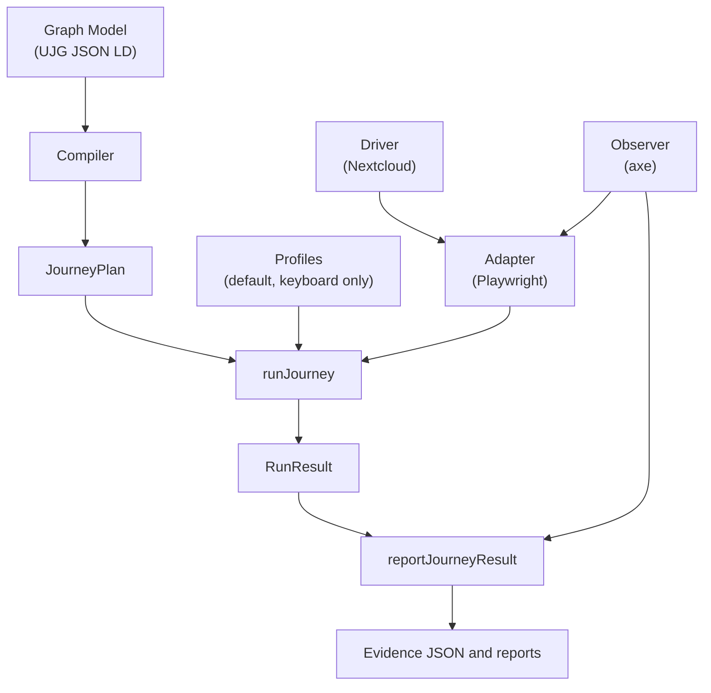

# journey-mesh

[](https://github.com/openuji/journey-mesh/actions/workflows/ci.yml)
[](https://github.com/openuji/journey-mesh/actions/workflows/example-ci.yml)

Model-driven execution and validation of cross-service user journeys, with pluggable model bindings, automation adapters, application drivers, interaction profiles, and evidence observers.

Links: [live demo](https://journey-mesh.openuji.org/#demo) · [roadmap](docs/roadmap.md) · [known-good accessibility report](https://journey-mesh.openuji.org/accessibility/filesharing/artifacts/nextcloud-filesharing.axe-path)

## Problem

Federated and multi-service systems can report that every service is healthy while the user journey is still broken at a boundary: account mapping, remote discovery, delayed delivery, upgrade compatibility, or evidence review. Journey Mesh makes the intended journey executable, then records evidence against the states and transitions in the model.


## Architecture




### Extension responsibilities

- Model bindings own model parsing, validation, source references, and execution-plan generation.
- Automation adapters own generic execution, resource isolation, and cleanup against an automation runtime such as Playwright or Appium.
- Application drivers are pure service-specific resolvers for entry targets and transition values; shared environments own fixture setup, effect verification, and cleanup.
- Interaction profiles own input-modality selection such as default pointer-first and keyboard-only operation.
- Observers own evidence collection and redaction for functional, accessibility, reliability, and deployment signals.
- Reporters own versioned output formats, human-readable summaries, and CI-compatible artifacts.

The runtime-neutral `JourneyAdapter` contract also supports composing adapters by
touchpoint with `touchpointAdapter(...)`. This allows different runtimes in one
journey. See [adapter contracts](docs/automation-adapters.md) and the
[Android migration path](docs/nextcloud-android.md). Model-defined input modalities,
profiles composed by touchpoint, and shared environment hooks keep runtime
commands and service fixtures out of the adapter contract.


## Available Today

- Generic runner, UJG binding, Playwright and Android Appium adapters, Nextcloud web/native drivers, composed input profiles, and web/native accessibility observers.
- A Nextcloud federated file-sharing example with web and explicit Alice-web/Bob-Android modes, local stack scripts, and CI artifact upload.
- Published demo and known-good report:
  [journey-mesh.openuji.org](https://journey-mesh.openuji.org/) and
  [nextcloud-filesharing.axe-path](https://journey-mesh.openuji.org/accessibility/filesharing/artifacts/nextcloud-filesharing.axe-path).

## Proposed Work

The proposed roadmap adds multipath-aware execution, stable extension contracts, Fediversity/Nix post-deployment and upgrade validation, expanded Nextcloud scenarios, a Mastodon driver, runtime reliability evidence, and improved reporting and documentation.

- [Technical roadmap](docs/roadmap.md)
- [Public roadmap issue](https://github.com/openuji/journey-mesh/issues/11)

The roadmap is proposed and is not a delivery commitment.

## YAML journey tests

Declare selected journeys and their adapters in one YAML file, then execute them
with the same command for any runtime combination:

```sh
journey-mesh test mesh.yaml --test browser-sharing
journey-mesh test mesh.yaml --test native-recipient-sharing
journey-mesh test mesh.yaml # all declared tests; prepare every configured runtime first
journey-mesh validate mesh.yaml --test browser-sharing
journey-mesh report test-results
```

The [Nextcloud configuration](examples/nextcloud-filesharing/mesh.yaml) contains
both browser-only and native-recipient tests. Fixtures and reporting belong to
the test; adapters own browser and device resources. See the
[configuration and plugin contract](docs/yaml-tests.md) and
[example setup](examples/nextcloud-filesharing/README.md).

## Limitations

- Current execution compiles the checked-in UJG into a linear plan; ambiguous branches are rejected.
- The only application binding in this repository is the pure Nextcloud web/Android reference driver.
- The example requires Docker and canonical Nextcloud URLs reachable by its runtimes; the local lifecycle commands provision a dedicated Android emulator and Appium service when native execution is selected.
- Accessibility evidence supports journey review, but it is not WCAG certification.
- Extension APIs and report formats are prototype contracts.
- Roadmap items are proposed work, not committed delivery.

## UJG Citation

The checked-in authoring model declares `ujgTarget: "1.0-rc1"` and the compiled JSON-LD model uses the UJG `1.0-rc1` context set. For the public community snapshot, cite the [UJG 1.0 Release Candidate 1](https://ujg.specs.openuji.org/tr/1.0-rc1), published 2026-07-27 by the [W3C User Journey Graph Community Group](https://www.w3.org/groups/cg/ujg/).

## Maintainers / Contact

Use [GitHub Issues](https://github.com/openuji/journey-mesh/issues) for bugs and focused technical feedback. Use the [public roadmap issue](https://github.com/openuji/journey-mesh/issues/11) for broad roadmap discussion.

## License

MIT. See [`LICENSE`](LICENSE).
