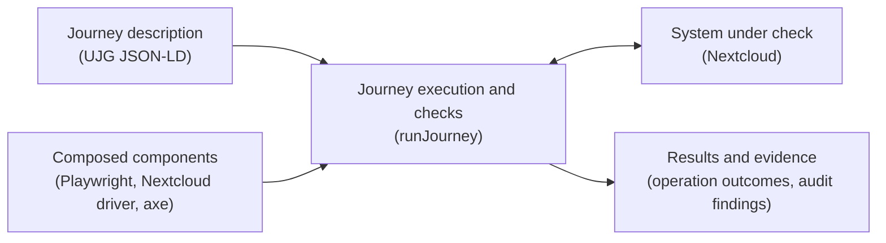
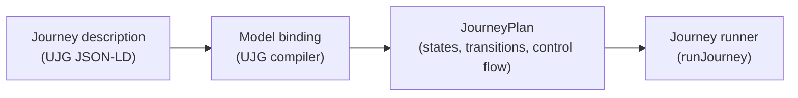
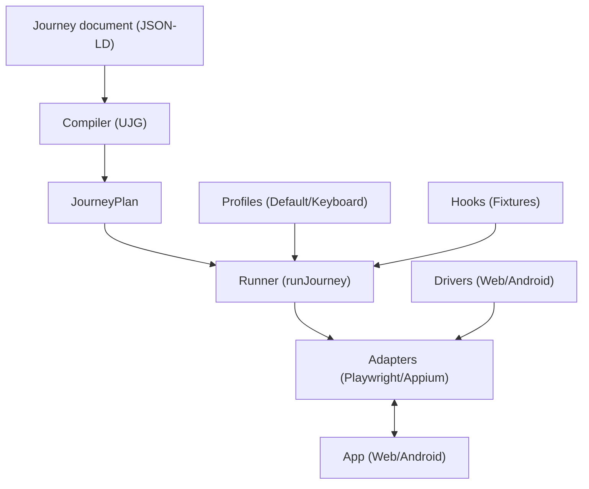
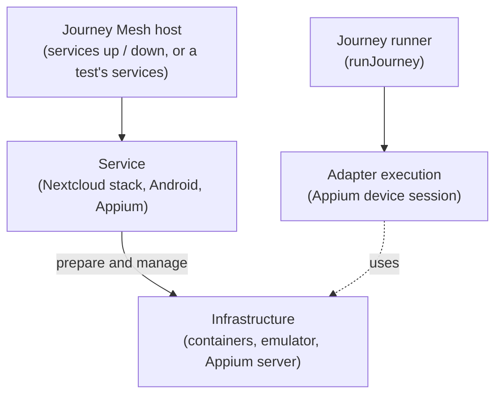
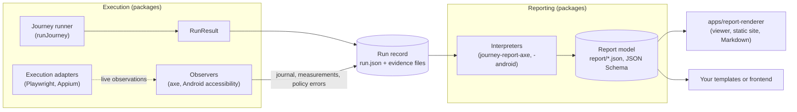
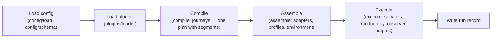

# journey-mesh

[](https://github.com/openuji/journey-mesh/actions/workflows/ci.yml)

Composable, model-driven execution and checking of user journeys. Choose how a
journey is described, how its steps are executed, and which evidence is collected
by plugging compatible components together.

In practice Journey Mesh is a configurable, multi-adapter, sequential journey
runner: one test composes several journeys (for example Alice in a browser, Bob
on Android) into one ordered plan, runs it once per interaction profile, and
saves outcomes and evidence in one run record.

## Problem

Healthy components do not guarantee that a user can complete a journey. The
journey can fail within an application or across service boundaries, through
interaction, account mapping, discovery, or delivery. Journey Mesh makes the
intended journey executable and records what happened against its model.

## Architecture

Journey Mesh separates the journey's intent from the mechanisms used to run and
check it. The execution core coordinates components through shared contracts.
The chosen components supply the application, platform, automation, provider,
and observation capabilities; the core does not prescribe those choices.
Examples in parentheses make each role concrete; they illustrate a composition
you can choose.

### Main blocks



A composition can use one execution adapter or combine several within one
journey. It can collect additional evidence through observers. Each component
brings its own capabilities and requirements; composition depends on compatible
contracts.

Running journeys and reporting on them are separate layers with one boundary:
execution writes a **run record**, and reporting derives a **report model** from
it. Rendering (HTML viewers, templates, Markdown) consumes that model and lives
outside the packages. See [architecture](docs/architecture.md).

### Description to plan



A model binding translates its source format into the shared execution model.
`JourneyPlan` carries ordered operations, expected states, transitions, input
requirements, effects, and source references. Automation handles stay within
adapters. Callers can also construct and supply a plan directly.

The current runner understands state, transition, and control-flow operations.
A new model binding must translate into those semantics; choosing a different
source format does not introduce new operation kinds into the runner.

### Execution composition



The journey document is the input to the model binding. In the illustrated
composition, the UJG compiler turns UJG JSON-LD into a `JourneyPlan`; the runner
receives that compiled plan. Other document formats can use their own bindings
to produce the same execution model.

The runner needs a plan, an adapter, and at least one profile. Profiles determine
applicability and select model-declared input modalities. Adapters translate
operations and selected modalities into execution commands, assert expected
states, and own their execution resources and cleanup.

An adapter can itself be a composition: `routedAdapter(...)` selects a child
adapter for each operation, while `touchpointAdapter(...)` offers routing by
touchpoint. Profiles can likewise be composed for different parts of a journey.
This lets one run span different execution mechanisms without putting their
commands into the runner.

Application drivers bind operations to an application by providing deterministic
entry targets and transition values through their adapter family's contract.
Optional environment hooks own shared fixture setup, declared-effect
verification, and teardown. Without a verification hook, declaring an effect
alone does not perform an external check.

Profiles and operations execute sequentially. A failed operation stops that
profile execution; adapter cleanup and environment teardown still run. Cleanup
failures are retained alongside the original failure.

### Services

A **service** is infrastructure a test needs, managed independently of any
single execution: a pinned Nextcloud stack, an Android emulator, an Appium
server. `JourneyService.start()` returns immutable outputs and provenance with
an explicit `release()` handle. The host registers each acquisition before
validating its outputs and releases handles in reverse order. Explicit CLI
shutdown reads component-scoped ownership records.



Each profile receives a fresh **adapter execution**, with `start()` and `close()`
owning resources such as browser contexts or device sessions. Closing that
execution leaves separately managed infrastructure available. The
**environment** has its own per-profile lifecycle for service fixtures and
effect checks, such as creating and verifying a shared file.

Services are optional; infrastructure can be provided externally. Declare them
under `services:` and either manage them explicitly:

```sh
journey-mesh services up mesh.yaml [--service android]
journey-mesh services down mesh.yaml
```

or list them on a test (`tests.<id>.services: [stack]`): `journey-mesh test` then
starts them with their `dependsOn` closure before the test and stops them
afterward, also after failures and cancellation. `runJourney(...)` itself never
sees services.

### Observation and reporting



**Execution** runs journeys and captures evidence. Observers keep detached
evidence and return calculated measurements and policy errors (for example axe
strict mode) through the observer output contract. The host collects them with
the immutable `RunResult` and writes one [run record](docs/run-record.md):
`run.json`, one record per test, and the registered evidence files. Nothing in
execution knows about reports: no presentation data, no HTML, no file-size
policy. A test's verdict depends only on execution and observer findings.

**Reporting** reads a run record and nothing else. Observer **interpreters**
turn recorded evidence into report data: the axe interpreter derives the path
report, a per-state summary, and journey-map node metrics; the Android
interpreter derives its evidence report. The reporting layer then joins plan,
execution, interpreter results and evidence files into the
[report model](docs/report-model.md): plain JSON below `<run>/report/`,
described by a JSON Schema. Problems while reporting (a failing interpreter, a
broken journey map) become report errors and never change a verdict.

**Rendering** is entirely an app's concern: what to do with the aggregated data
(a viewer, a static site, Markdown, your own templates) is decided outside the
packages. [`apps/report-renderer`](apps/report-renderer) is one such app: an
interactive viewer (journey map with outcomes and node metrics, profile switch,
comparisons, axe and Android views), static site publication with its own
hosting limits, and a Markdown summary. Any template engine or frontend can read
the same JSON.

`journey-mesh test` composes both layers: it writes the run record, then builds
`report/` from the `report:` section of the mesh:

```yaml
report:
  excludedPhaseIds:
    - urn:phase:setup
  interpreters:
    - use: "@openuji/journey-report-axe"
    - use: "@openuji/journey-report-android"
```

The host accepts `report` sections but never reads them. Phase exclusions are
presentation only: excluded phases still execute and keep their evidence. A test
may replace them with its own `report.excludedPhaseIds`.

A model binding may offer `view(source)`, a snapshot of the model document
behind a journey source; the host records it with the run, so reports need no
model sources. The UJG binding projects the `.ujg.jsonld` document it executes
into the journey-map format, preserving `Persona` nodes and touchpoints.
Catalogue documents provide a `JourneyEntryIndex` with the entries to discover.

### Component responsibilities

| Component | Responsibility | When needed |
| --- | --- | --- |
| Model binding | Parse and validate a source model; produce a plan and source references | When translating a journey description into a plan |
| Execution adapter | Execute operations, check states, manage execution resources and cleanup | Required; may route to several child adapters |
| Service | Prepare infrastructure across executions; return outputs, provenance and a release handle from `start()` | Optional; infrastructure may be managed externally |
| Application driver | Resolve application entry targets and transition values | When required by the selected adapter |
| Interaction profile | Assess applicability and select declared input modalities | At least one profile per run |
| Environment | Set up shared fixtures, verify effects, and tear down fixtures | Optional |
| Runner observer | Observe run and execution lifecycle events | Optional |
| Adapter observer | Collect evidence at the adapter's observation boundary | Optional; must match the adapter contract |
| Report interpreter | Derive report data (documents, node metrics) from one observer's recorded evidence | Optional; reporting layer, after execution |

Drivers and live observers follow their adapter's contracts. Input modality IDs
are open model identifiers; a profile must choose a declared modality that the
selected adapter can execute. Replacing a component means satisfying these
contracts and the selected journey's requirements.

### Ways to compose a run

**Programmatically:** supply components to `runJourney(...)`. To report on a
host run, call `buildReport(runDirectory, { config })` from
[`journey-reporter`](packages/journey-reporter/src/index.ts). See the
[runner API](packages/journey-runner/src/index.ts) and
[execution model](packages/journey-execution-model/src/index.ts).

**Through configuration:** the YAML/CLI host
([`journey-host`](packages/journey-host/src/index.ts)) runs one linear pipeline:



Every selected test is compiled and assembled before anything starts, so a
broken test never leaves fixtures or services behind. Each configured journey
becomes a **segment** of the test plan; the host routes operations to adapters
and profiles by segment. The host checks plugin kinds, driver contracts and
observer **automation** compatibility (`playwright`, `appium`). See the
[configuration schema](packages/journey-host/src/config/schema.ts) and the
[plugin contracts](packages/journey-plugin/src/plugins.ts).

```sh
journey-mesh validate mesh.yaml [other.mesh.yaml ...] [--test <id>]
journey-mesh test mesh.yaml [--test <id>] [--output <dir>] [--no-report]
journey-mesh report <run-dir> [--config mesh.yaml]          # rebuild report/ from the run record
journey-mesh export <run-dir> [--output <file>] [--data]    # the report as one JSON value
journey-mesh compare <baseline-run> <candidate-run> [--pairings <file>] [--title <text>] [--config mesh.yaml] [--output <dir>]
journey-mesh services up|down mesh.yaml [--service <key>]
```

Rendering is done by apps, for example
[`apps/report-renderer`](apps/report-renderer/README.md):
`pnpm --filter @openuji/report-renderer serve|site|markdown <run-dir>`.

To view the Nextcloud example's generated results, run this from the repository
root, then open <http://127.0.0.1:9323/>:

```sh
pnpm --filter @openuji/report-renderer serve examples/nextcloud-filesharing/test-results
```

Pass the run directory containing `report/` and the evidence files. Build the
viewer once with `pnpm build` if needed. The server reads the existing results;
viewing a report does not run the tests again. Stop it with Ctrl-C, or choose
another port with `--port 9324`.

`journey-mesh test` exits 0 when every test passed, 1 when a test failed, 2 for
configuration errors, and 3 when the tests passed but the report could not be
built.

See [service composition](docs/service-composition.md) to declare a PR source once and compose reusable source, build, and installation routines through named service inputs/outputs. The suite `target` selects the verified installed identity. The [HTTP environment plugin](packages/journey-environment-http/README.md) supplies declarative fixtures and read-only checks of model-declared effects.

### Writing a plugin

A plugin module exports `journeyMeshPlugin`, built with a typed helper from
[`@openuji/journey-plugin`](packages/journey-plugin/src/index.ts). `parse`
validates the raw YAML options into typed settings; `create` builds the
component from them. Neither may allocate automation resources or mutate
services. Validation parses settings and calls the adapter's pure
`validateOperations` hook. Runtime adapters, observers and environments are
constructed after services start, with fresh instances for each run.
Services and adapters receive frozen constructor input records; parsers receive
only configured input names. See [service composition](docs/service-composition.md)
for the plugin API migration and resource ownership rules.

```ts
import { defineObserverPlugin, knownOptions, requiredString } from "@openuji/journey-plugin";
import { playwrightAutomation } from "@openuji/journey-adapter-playwright";

export const journeyMeshPlugin = defineObserverPlugin({
  kind: "observer", automation: playwrightAutomation,
  parse(options) { knownOptions(options, ["id"]); return { id: requiredString(options.id, "id") }; },
  create({ id }) { const observer = myObserver(id); return { observer, output: ({ result }) => observer.output(result) }; }
});
```

Kinds are `model`, `adapter`, `driver`, `observer`, `profile`, `environment`
and `service`. Driver and automation contracts are typed, so an adapter receives
its driver and observers without casts. Reporting extensions are not plugins of
the run: an observer's report-side code is an interpreter module exporting
`journeyMeshInterpreter` (see [report model](docs/report-model.md)).

The configuration host and CLI use Node.js. The runner's main entry has no Node
builtin or automation-runtime imports, and is checked in a restricted VM by the
[portability test](packages/journey-runner/test/runner-portability.mjs). Its
separate console helper uses Node.js. Infrastructure lifecycle plugins are
optional host tooling, independent of an individual journey execution.

## Comparison and reporting

A configuration is a suite (`kind: suite`). It selects a model binding,
journeys, adapters, profiles, observers and services, and may name the system
under test with `label:`. Its `report` section configures the reporting layer.

A comparison is not a configuration: it is a step over two run directories.
Run each subject as an ordinary suite, then compare them:

```sh
journey-mesh validate baseline.mesh.yaml candidate.mesh.yaml   # preflight both before either starts
journey-mesh test baseline.mesh.yaml
journey-mesh test candidate.mesh.yaml
journey-mesh compare baseline-results candidate-results --output comparison
```

`compare` executes nothing. It copies each subject's run record, evidence and
report to `subjects/<baseline|candidate>/`, pairs executions with equal test and
profile IDs, and writes the comparison model to `report/report.json` atomically.
The viewer shows both journey maps together for the selected scenario and
profile and links to each subject's full report. Different IDs need an explicit
pairings file:

```yaml
- id: same-purpose
  baseline: { test: first-journey, profile: pointer }
  candidate: { test: different-journey, profile: keyboard }
```

A failed subject keeps its evidence, and a missing subject is reported as that
subject's error without hiding the other. `compare` exits nonzero when either
subject did not pass.

Observers own their findings, metric definitions, values, and evidence.
Numeric differences require matching metric identity, method, unit, aggregation,
and value type; partial or unavailable values have no delta. Adapter command
counts are not physical keystroke counts.

Journey items can declare `operations: { alias: <model-specific selector> }`.
The model binding resolves these during preparation; observers refer to
`journey-item.alias` and receive compiled operation identities, so two subjects
can use the same alias names for different model operations. Generic execution,
measurement, and reporting do not interpret UJG source identifiers.

Publishing a run or comparison as a static site, with hosting limits, is a
feature of the renderer app, not of the packages.

## Available integrations and examples

The repository currently includes:

- A UJG JSON-LD model binding and input-modality profiles.
- Playwright and Android Appium adapters, with Nextcloud web/native drivers.
- Android emulator, Appium server and pinned Nextcloud stack service plugins.
- Axe and Android accessibility observers and reporters.
- An optional UX observer with pure metric derivation.

The [Nextcloud file-sharing example](examples/nextcloud-filesharing/README.md)
demonstrates two compositions of the same architecture:

- [Browser sharing](examples/nextcloud-filesharing/README.md#run-the-browser-test):
  both participants use web execution, with default and keyboard-only profiles.
- [Web/native sharing](examples/nextcloud-filesharing/README.md#run-the-native-recipient-test):
  one participant uses web execution and the other uses Android, within one run.

Concrete diagrams, configuration, prerequisites, lifecycle commands, and evidence
limits live in the example. Other integrations can implement the extension
contracts; the implementations above are the ones supplied today.

For further examples of Journey Mesh in use, see
[journey-checks](https://github.com/openuji/journey-checks). It runs journeys
against targets this project does not control, such as an open Nextcloud pull
request, using a tagged Journey Mesh release, and publishes one JSON result per
check. Each check is a self-contained mesh that uses this repository's packages.

Explore the [live demo](https://journey-mesh.openuji.org/#demo) and
[known-good accessibility report](https://journey-mesh.openuji.org/accessibility/filesharing/artifacts/nextcloud-filesharing.axe-path).

## Current limitations

- The shipped UJG compiler produces deterministic linear plans; ambiguous
  branches and cycles are rejected.
- Only Nextcloud application drivers are currently supplied in this repository.
  Deployment and platform prerequisites depend on the selected integrations.
- Accessibility evidence supports journey review; it does not certify conformance.
- Extension APIs and report formats are prototype contracts.

## Proposed Work

The proposed roadmap adds multipath-aware execution, stable extension contracts, Fediversity/Nix post-deployment and upgrade validation, expanded Nextcloud scenarios, a Mastodon driver, runtime reliability evidence, and improved reporting and documentation.

- [Public roadmap issue](https://github.com/openuji/journey-mesh/issues/11)

The roadmap is proposed and is not a delivery commitment.

## UJG Citation

The checked-in authoring model declares `ujgTarget: "1.0-rc3"` and the compiled JSON-LD model uses the UJG `1.0-rc3` context set. For the public community snapshot, cite the [UJG 1.0 Release Candidate 3](https://ujg.specs.openuji.org/tr/1.0-rc3), published 2026-11-09 by the [W3C User Journey Graph Community Group](https://www.w3.org/groups/cg/ujg/).

## Maintainers / Contact

Use [GitHub Issues](https://github.com/openuji/journey-mesh/issues) for bugs and focused technical feedback. Use the [public roadmap issue](https://github.com/openuji/journey-mesh/issues/11) for broad roadmap discussion.

## License

MIT. See [`LICENSE`](LICENSE).
