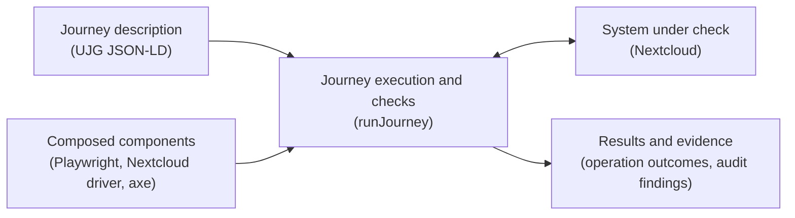
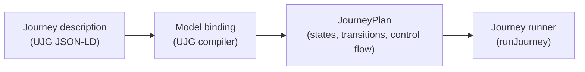
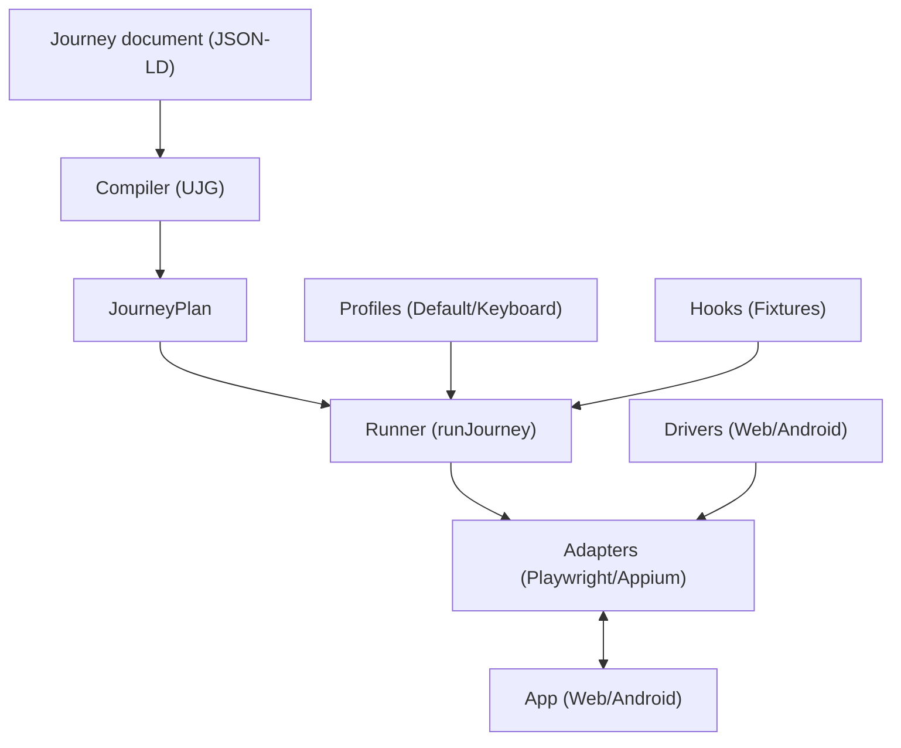
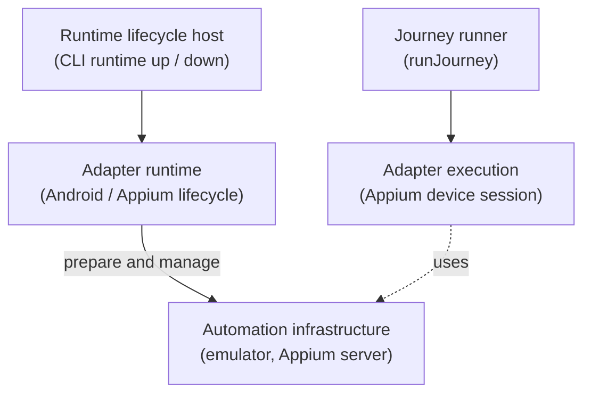
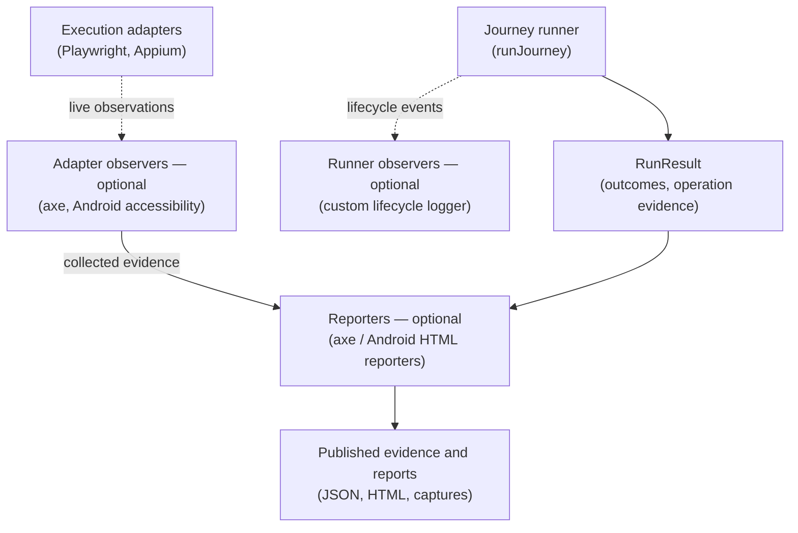

# journey-mesh

[](https://github.com/openuji/journey-mesh/actions/workflows/ci.yml)

Composable, model-driven execution and checking of user journeys. Choose how a
journey is described, how its steps are executed, and which evidence is collected
by plugging compatible components together.

## Problem

Healthy components do not guarantee that a user can complete a journey. The
journey can fail within an application or across service boundaries, through
interaction, account mapping, discovery, or delivery. Journey Mesh makes the
intended journey executable and records what happened against its model.

## Architecture

Journey Mesh separates the journey's intent from the mechanisms used to run and
check it. The execution core coordinates components through shared contracts.
The chosen components supply the application, platform, automation, provider,
and observation capabilities; the core does not prescribe those choices.
Examples in parentheses make each role concrete; they illustrate a composition
you can choose.

### Main blocks



A composition can use one execution adapter or combine several within one
journey. It can collect additional evidence through observers and publish it
through reporters. Each component brings its own capabilities and requirements;
composition depends on compatible contracts.

### Description to plan



A model binding translates its source format into the shared execution model.
`JourneyPlan` carries ordered operations, expected states, transitions, input
requirements, effects, and source references. Automation handles stay within
adapters. Callers can also construct and supply a plan directly.

The current runner understands state, transition, and control-flow operations.
A new model binding must translate into those semantics; choosing a different
source format does not introduce new operation kinds into the runner.

### Execution composition



The journey document is the input to the model binding. In the illustrated
composition, the UJG compiler turns UJG JSON-LD into a `JourneyPlan`; the runner
receives that compiled plan. Other document formats can use their own bindings
to produce the same execution model.

The runner needs a plan, an adapter, and at least one profile. Profiles determine
applicability and select model-declared input modalities. Adapters translate
operations and selected modalities into execution commands, assert expected
states, and own their execution resources and cleanup.

An adapter can itself be a composition: `routedAdapter(...)` selects a child
adapter for each operation, while `touchpointAdapter(...)` offers routing by
touchpoint. Profiles can likewise be composed for different parts of a journey.
This lets one run span different execution mechanisms without putting their
commands into the runner.

Application drivers bind operations to an application by providing deterministic
entry targets and transition values through their adapter family's contract.
Optional environment hooks own shared fixture setup, declared-effect
verification, and teardown. Without a verification hook, declaring an effect
alone does not perform an external check.

Profiles and operations execute sequentially. A failed operation stops that
profile execution; adapter cleanup and environment teardown still run. Cleanup
failures are retained alongside the original failure.

### Adapter runtime lifecycle

An **adapter runtime** manages the automation infrastructure used by adapter
executions. `JourneyAdapterRuntime` exposes `up()` and an optional `down()` for
preparing, starting, and stopping that infrastructure. It can stay available
across multiple profile executions and journey runs.



Each profile receives a fresh **adapter execution**, with `start()` and `close()`
owning resources such as browser contexts or device sessions. Closing that
execution leaves separately managed infrastructure available. The
**environment** has its own per-profile lifecycle for service fixtures and
effect checks, such as creating and verifying a shared file.

Runtime lifecycle management is optional: infrastructure can be provided
externally. The YAML host loads runtime plugins from `runtimes` and manages them
through explicit commands:

```sh
journey-mesh runtime up mesh.yaml
journey-mesh runtime down mesh.yaml
```

`journey-mesh test` does not automatically start or stop these runtimes, and
`runJourney(...)` does not receive an adapter runtime. See the
[lifecycle contracts](packages/journey-runner/src/adapters/contracts.ts).
The `runtime` tag on adapter and observer plugins identifies compatibility
(for example, `playwright` or `appium`); it is separate from the `runtimes`
configuration that manages infrastructure.

### Observation and reporting



Functional outcomes and operation evidence are part of `RunResult`, even when no
additional observer is installed. Runner observers receive run and execution
lifecycle events. Adapter observers receive observations through an
adapter-specific contract, which may expose live runtime handles.

Observers can retain detached evidence and also implement a reporter. Reporting
runs separately after execution and can combine that evidence with the immutable
`RunResult`. Reporting errors remain separate from execution history. Collection
errors during execution can still fail the execution.

### Component responsibilities

| Component | Responsibility | When needed |
| --- | --- | --- |
| Model binding | Parse and validate a source model; produce a plan and source references | When translating a journey description into a plan |
| Execution adapter | Execute operations, check states, manage execution resources and cleanup | Required; may route to several child adapters |
| Adapter runtime | Prepare and manage automation infrastructure across executions; expose `up()` and optional `down()` | Optional; infrastructure may be managed externally |
| Application driver | Resolve application entry targets and transition values | When required by the selected adapter |
| Interaction profile | Assess applicability and select declared input modalities | At least one profile per run |
| Environment | Set up shared fixtures, verify effects, and tear down fixtures | Optional |
| Runner observer | Observe run and execution lifecycle events | Optional |
| Adapter observer | Collect evidence at the adapter's observation boundary | Optional; must match the adapter contract |
| Reporter | Publish results and any collected evidence | Optional, after execution |

Drivers and live observers follow their adapter's contracts. Input modality IDs
are open model identifiers; a profile must choose a declared modality that the
selected adapter can execute. Replacing a component means satisfying these
contracts and the selected journey's requirements.

### Ways to compose a run

**Programmatically:** supply components to `runJourney(...)`, then optionally
publish the result with `reportJourneyResult(...)`. See the
[runner API](packages/journey-runner/src/index.ts) and
[execution model](packages/journey-execution-model/src/index.ts).

**Through configuration:** the supplied YAML/CLI host loads plugins, compiles
selected journeys, composes profiles, and routes operations to adapters. It
validates every selected test before starting shared fixture setup. The host
checks plugin API versions and kinds, driver contracts, and observer runtime
compatibility. See the [configuration types](packages/journey-runtime/src/config.ts)
and [plugin contract](packages/journey-runtime/src/plugin.ts).

```sh
journey-mesh validate mesh.yaml
journey-mesh test mesh.yaml
journey-mesh report test-results
```

The configuration host and CLI use Node.js. The runner's main entry has no Node
builtin or automation-runtime imports, and is checked in a restricted VM by the
[portability test](packages/journey-runner/test/runner-portability.mjs). Its
separate console helper uses Node.js. Infrastructure lifecycle plugins are
optional host tooling, independent of an individual journey execution.

## Available integrations and examples

The repository currently includes:

- A UJG JSON-LD model binding and input-modality profiles.
- Playwright and Android Appium adapters, with Nextcloud web/native drivers.
- Android emulator and Appium server runtime lifecycle plugins.
- Axe and Android accessibility observers and reporters.
- An optional UX observer with pure metric derivation and a
  [versioned Nextcloud acceptance report](examples/nextcloud-comparison-report/README.md).

The [Nextcloud file-sharing example](examples/nextcloud-filesharing/README.md)
demonstrates two compositions of the same architecture:

- [Browser sharing](examples/nextcloud-filesharing/README.md#run-the-browser-test):
  both participants use web execution, with default and keyboard-only profiles.
- [Web/native sharing](examples/nextcloud-filesharing/README.md#run-the-native-recipient-test):
  one participant uses web execution and the other uses Android, within one run.

Concrete diagrams, configuration, prerequisites, lifecycle commands, and evidence
limits live in the example. Other integrations can implement the extension
contracts; the implementations above are the ones supplied today.

Explore the [live demo](https://journey-mesh.openuji.org/#demo) and
[known-good accessibility report](https://journey-mesh.openuji.org/accessibility/filesharing/artifacts/nextcloud-filesharing.axe-path).

## Current limitations

- The shipped UJG compiler produces deterministic linear plans; ambiguous
  branches and cycles are rejected.
- Only Nextcloud application drivers are currently supplied in this repository.
  Deployment and platform prerequisites depend on the selected integrations.
- Accessibility evidence supports journey review; it does not certify conformance.
- Extension APIs and report formats are prototype contracts.

## Proposed Work

The proposed roadmap adds multipath-aware execution, stable extension contracts, Fediversity/Nix post-deployment and upgrade validation, expanded Nextcloud scenarios, a Mastodon driver, runtime reliability evidence, and improved reporting and documentation.

- [Public roadmap issue](https://github.com/openuji/journey-mesh/issues/11)

The roadmap is proposed and is not a delivery commitment.

## UJG Citation

The checked-in authoring model declares `ujgTarget: "1.0-rc3"` and the compiled JSON-LD model uses the UJG `1.0-rc3` context set. For the public community snapshot, cite the [UJG 1.0 Release Candidate 3](https://ujg.specs.openuji.org/tr/1.0-rc3), published 2026-11-09 by the [W3C User Journey Graph Community Group](https://www.w3.org/groups/cg/ujg/).

## Maintainers / Contact

Use [GitHub Issues](https://github.com/openuji/journey-mesh/issues) for bugs and focused technical feedback. Use the [public roadmap issue](https://github.com/openuji/journey-mesh/issues/11) for broad roadmap discussion.

## License

MIT. See [`LICENSE`](LICENSE).
