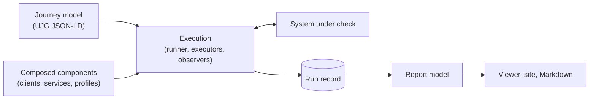

# journey-mesh

[](https://github.com/openuji/journey-mesh/actions/workflows/ci.yml)

Composable, model-driven execution and checking of user journeys.

Healthy components do not guarantee that a user can complete a journey: it can
fail inside an application or across service boundaries, through interaction,
account mapping, discovery or delivery. Journey Mesh makes the intended journey
executable and records what happened against its model.

One test composes several journeys (for example Alice in a browser, Bob on
Android) into one ordered plan, runs it once per interaction profile, and saves
outcomes and evidence in one run record. A report is derived from that record.



Architecture, roles and invariants: [docs/architecture.md](docs/architecture.md).

## Quick start

Requires Node 22 and pnpm 10; the examples also need Docker with Compose.

```sh
pnpm install --frozen-lockfile
pnpm build
pnpm test && pnpm lint
pnpm exec journey-mesh --help
```

## Examples

- [Nextcloud file sharing](examples/nextcloud-filesharing): federated sharing
  across two instances, browser-only and browser-plus-Android in one run.
- [Moodle user tour viewport](examples/moodle-usertour-viewport): reproduces a
  Moodle bug at its baseline commit and shows the fix.
- [journey-checks](https://github.com/openuji/journey-checks): journeys against
  targets this project does not control, such as an open pull request.

[Live demo](https://journey-mesh.openuji.org/#demo)

## Status

The model binding targets [UJG 1.0 RC4](https://ujg.specs.openuji.org/tr/1.0-rc4)
from the [W3C User Journey Graph Community Group](https://www.w3.org/groups/cg/ujg/).
Extension APIs and report formats are prototype contracts. Accessibility
evidence supports journey review; it does not certify conformance.

Roadmap: [issue #11](https://github.com/openuji/journey-mesh/issues/11)
(proposed, not a delivery commitment).

## Contact

[GitHub Issues](https://github.com/openuji/journey-mesh/issues) for bugs and
technical feedback.

## License

MIT. See [`LICENSE`](LICENSE).
