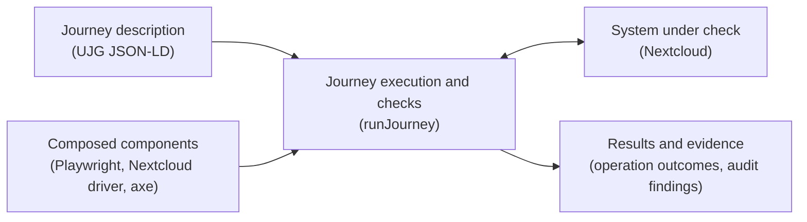
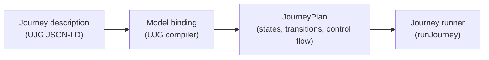
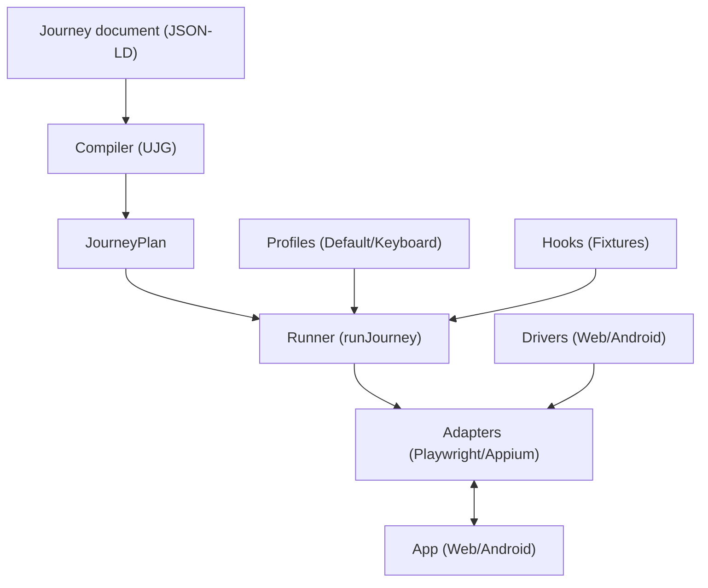
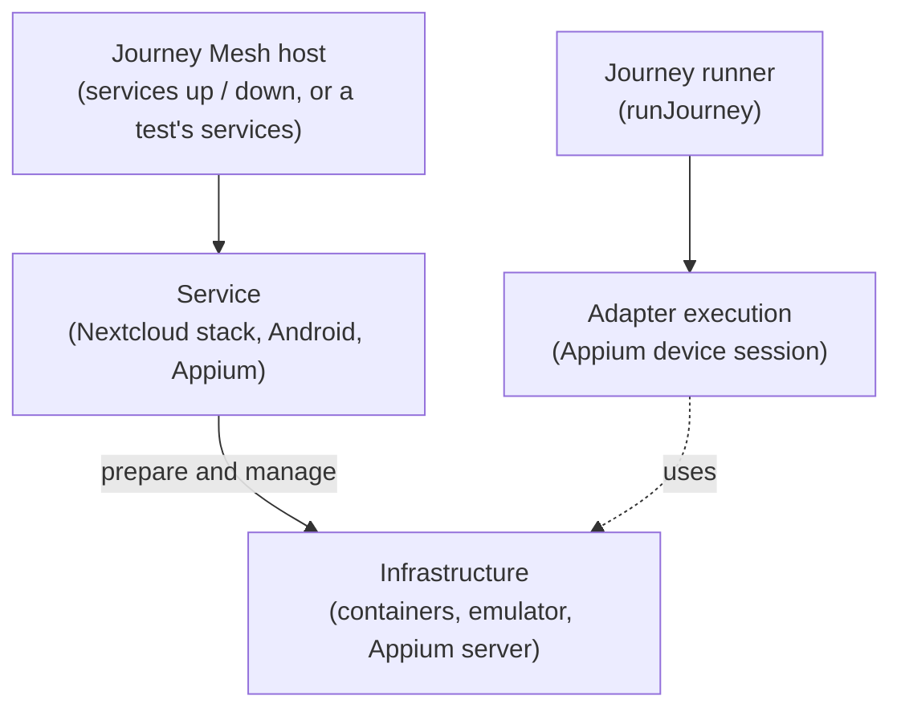
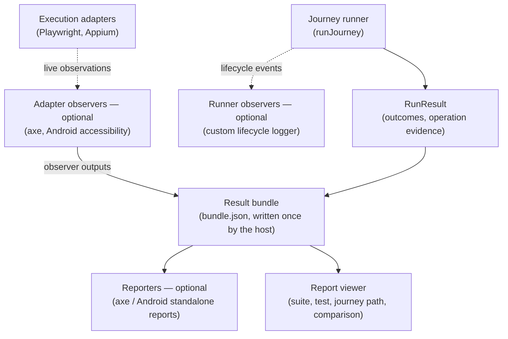
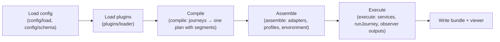

# journey-mesh

[](https://github.com/openuji/journey-mesh/actions/workflows/ci.yml)

Composable, model-driven execution and checking of user journeys. Choose how a
journey is described, how its steps are executed, and which evidence is collected
by plugging compatible components together.

In practice Journey Mesh is a configurable, multi-adapter, sequential journey
runner: one test composes several journeys (for example Alice in a browser, Bob
on Android) into one ordered plan, runs it once per interaction profile, and
saves outcomes and evidence in a single result bundle.

## Problem

Healthy components do not guarantee that a user can complete a journey. The
journey can fail within an application or across service boundaries, through
interaction, account mapping, discovery, or delivery. Journey Mesh makes the
intended journey executable and records what happened against its model.

## Architecture

Journey Mesh separates the journey's intent from the mechanisms used to run and
check it. The execution core coordinates components through shared contracts.
The chosen components supply the application, platform, automation, provider,
and observation capabilities; the core does not prescribe those choices.
Examples in parentheses make each role concrete; they illustrate a composition
you can choose.

### Main blocks



A composition can use one execution adapter or combine several within one
journey. It can collect additional evidence through observers and publish it
through reporters. Each component brings its own capabilities and requirements;
composition depends on compatible contracts.

### Description to plan



A model binding translates its source format into the shared execution model.
`JourneyPlan` carries ordered operations, expected states, transitions, input
requirements, effects, and source references. Automation handles stay within
adapters. Callers can also construct and supply a plan directly.

The current runner understands state, transition, and control-flow operations.
A new model binding must translate into those semantics; choosing a different
source format does not introduce new operation kinds into the runner.

### Execution composition



The journey document is the input to the model binding. In the illustrated
composition, the UJG compiler turns UJG JSON-LD into a `JourneyPlan`; the runner
receives that compiled plan. Other document formats can use their own bindings
to produce the same execution model.

The runner needs a plan, an adapter, and at least one profile. Profiles determine
applicability and select model-declared input modalities. Adapters translate
operations and selected modalities into execution commands, assert expected
states, and own their execution resources and cleanup.

An adapter can itself be a composition: `routedAdapter(...)` selects a child
adapter for each operation, while `touchpointAdapter(...)` offers routing by
touchpoint. Profiles can likewise be composed for different parts of a journey.
This lets one run span different execution mechanisms without putting their
commands into the runner.

Application drivers bind operations to an application by providing deterministic
entry targets and transition values through their adapter family's contract.
Optional environment hooks own shared fixture setup, declared-effect
verification, and teardown. Without a verification hook, declaring an effect
alone does not perform an external check.

Profiles and operations execute sequentially. A failed operation stops that
profile execution; adapter cleanup and environment teardown still run. Cleanup
failures are retained alongside the original failure.

### Services

A **service** is infrastructure a test needs, managed independently of any
single execution: a pinned Nextcloud stack, an Android emulator, an Appium
server. `JourneyService` exposes `up()`, an optional `down()`, and an optional
`provenance()` that records what was provided (versions, image digests) in the
suite bundle.



Each profile receives a fresh **adapter execution**, with `start()` and `close()`
owning resources such as browser contexts or device sessions. Closing that
execution leaves separately managed infrastructure available. The
**environment** has its own per-profile lifecycle for service fixtures and
effect checks, such as creating and verifying a shared file.

Services are optional; infrastructure can be provided externally. Declare them
under `services:` and either manage them explicitly:

```sh
journey-mesh services up mesh.yaml [--service android]
journey-mesh services down mesh.yaml
```

or list them on a test (`tests.<id>.services: [stack]`): `journey-mesh test` then
starts them with their `dependsOn` closure before the test and stops them
afterward, also after failures and cancellation. `runJourney(...)` itself never
sees services.

### Observation and reporting



Functional outcomes and operation evidence are part of `RunResult`, even when no
additional observer is installed. Runner observers receive run and execution
lifecycle events. Adapter observers receive observations through an
adapter-specific contract, which may expose live runtime handles.

Observers retain detached evidence and provide calculated measurements through
the shared observer output contract. The host collects those outputs with the
immutable `RunResult` into a result bundle; reporters then write
provider-specific files (for example the axe path report) next to it. Only the
host writes `bundle.json`, once per output directory, and it holds no absolute
paths, so a report directory can be moved or published as is. Reporting errors
remain separate from execution history. Collection errors during execution can
still fail the execution.

The report viewer is a single Vite/React application published next to every
`bundle.json`. It renders suites, tests, journey paths (via the vendored
journey-path component) and comparisons directly from the saved bundle; no
reporter needs to be configured for it.

### Component responsibilities

| Component | Responsibility | When needed |
| --- | --- | --- |
| Model binding | Parse and validate a source model; produce a plan and source references | When translating a journey description into a plan |
| Execution adapter | Execute operations, check states, manage execution resources and cleanup | Required; may route to several child adapters |
| Service | Prepare and manage infrastructure across executions; expose `up()`, optional `down()` and `provenance()` | Optional; infrastructure may be managed externally |
| Application driver | Resolve application entry targets and transition values | When required by the selected adapter |
| Interaction profile | Assess applicability and select declared input modalities | At least one profile per run |
| Environment | Set up shared fixtures, verify effects, and tear down fixtures | Optional |
| Runner observer | Observe run and execution lifecycle events | Optional |
| Adapter observer | Collect evidence at the adapter's observation boundary | Optional; must match the adapter contract |
| Reporter | Publish results and any collected evidence | Optional, after execution |

Drivers and live observers follow their adapter's contracts. Input modality IDs
are open model identifiers; a profile must choose a declared modality that the
selected adapter can execute. Replacing a component means satisfying these
contracts and the selected journey's requirements.

### Ways to compose a run

**Programmatically:** supply components to `runJourney(...)`, then optionally
publish a result bundle with `reportJourneyResult(...)` from
[`journey-reporter`](packages/journey-reporter/src/index.ts). See the
[runner API](packages/journey-runner/src/index.ts) and
[execution model](packages/journey-execution-model/src/index.ts).

**Through configuration:** the YAML/CLI host
([`journey-host`](packages/journey-host/src/index.ts)) runs one linear pipeline:



Every selected test is compiled and assembled before anything starts, so a
broken test never leaves fixtures or services behind. Each configured journey
becomes a **segment** of the test plan; the host routes operations to adapters
and profiles by segment. The host checks plugin kinds, driver contracts and
observer **automation** compatibility (`playwright`, `appium`). See the
[configuration schema](packages/journey-host/src/config/schema.ts) and the
[plugin contracts](packages/journey-plugin/src/plugins.ts).

```sh
journey-mesh validate mesh.yaml [other.mesh.yaml ...] [--test <id>]
journey-mesh test mesh.yaml [--test <id>] [--output <dir>]
journey-mesh compare baseline/bundle.json candidate/bundle.json [--pairings <file>] [--title <text>] [--output <dir>]
journey-mesh render bundle.json [--output <dir>]
journey-mesh report <dir>
journey-mesh services up|down mesh.yaml [--service <key>]
```

### Writing a plugin

A plugin module exports `journeyMeshPlugin`, built with a typed helper from
[`@openuji/journey-plugin`](packages/journey-plugin/src/index.ts). `parse`
validates the raw YAML options into typed settings; `create` builds the
component from them. Neither may allocate automation resources or mutate
services, because `journey-mesh validate` calls both.

```ts
import { defineObserverPlugin, knownOptions, requiredString } from "@openuji/journey-plugin";
import { playwrightAutomation } from "@openuji/journey-adapter-playwright";

export const journeyMeshPlugin = defineObserverPlugin({
  kind: "observer", automation: playwrightAutomation,
  parse(options) { knownOptions(options, ["id"]); return { id: requiredString(options.id, "id") }; },
  create({ id }) { const observer = myObserver(id); return { observer, output: ({ result }) => observer.output(result) }; }
});
```

Kinds are `model`, `adapter`, `driver`, `observer`, `profile`, `environment`,
`service` and `reporter`. Driver and automation contracts are typed, so an
adapter receives its driver and observers without casts.

The configuration host and CLI use Node.js. The runner's main entry has no Node
builtin or automation-runtime imports, and is checked in a restricted VM by the
[portability test](packages/journey-runner/test/runner-portability.mjs). Its
separate console helper uses Node.js. Infrastructure lifecycle plugins are
optional host tooling, independent of an individual journey execution.

## Comparison and reporting

A configuration is a suite (`kind: suite`). It selects a model binding,
journeys, adapters, profiles, observers, reporters and services, and may name the
system under test with `label:`.

A comparison is not a configuration: it is a step over two saved suite runs.
Run each subject as an ordinary suite, then compare their bundles:

```sh
journey-mesh validate baseline.mesh.yaml candidate.mesh.yaml   # preflight both before either starts
journey-mesh test baseline.mesh.yaml
journey-mesh test candidate.mesh.yaml
journey-mesh compare baseline-results/bundle.json candidate-results/bundle.json --output comparison
```

`compare` loads no plugins and executes nothing. It copies each subject's
registered evidence to `subjects/<baseline|candidate>/`, pairs executions with
equal test and profile IDs, and publishes the comparison bundle with the viewer
atomically. Different IDs need an explicit pairings file:

```yaml
- id: same-purpose
  baseline: { test: first-journey, profile: pointer }
  candidate: { test: different-journey, profile: keyboard }
```

A failed subject keeps its evidence, and a missing subject bundle is reported as
that subject's error without hiding the other. `compare` exits nonzero when
either subject did not pass.

Observers own their findings, metric definitions, values, and evidence.
Numeric differences require matching metric identity, method, unit, aggregation,
and value type; partial or unavailable values have no delta. Adapter command
counts are not physical keystroke counts.

Journey items can declare `operations: { alias: <model-specific selector> }`.
The model binding resolves these during preparation; observers refer to
`journey-item.alias` and receive compiled operation identities, so two subjects
can use the same alias names for different model operations. Generic execution,
measurement, and reporting do not interpret UJG source identifiers.

`journey-mesh render` republishes a saved suite or comparison bundle, with only
its registered evidence and the viewer, into another directory. Configuration,
plugin, and report contracts have one current shape, with no version fields or
legacy readers. See the
[Nextcloud comparison](examples/nextcloud-filesharing/README.md#compare-independent-deployments).

## Available integrations and examples

The repository currently includes:

- A UJG JSON-LD model binding and input-modality profiles.
- Playwright and Android Appium adapters, with Nextcloud web/native drivers.
- Android emulator, Appium server and pinned Nextcloud stack service plugins.
- Axe and Android accessibility observers and reporters.
- An optional UX observer with pure metric derivation and a
  [configured Nextcloud comparison](examples/nextcloud-filesharing/README.md#compare-independent-deployments).

The [Nextcloud file-sharing example](examples/nextcloud-filesharing/README.md)
demonstrates two compositions of the same architecture:

- [Browser sharing](examples/nextcloud-filesharing/README.md#run-the-browser-test):
  both participants use web execution, with default and keyboard-only profiles.
- [Web/native sharing](examples/nextcloud-filesharing/README.md#run-the-native-recipient-test):
  one participant uses web execution and the other uses Android, within one run.

Concrete diagrams, configuration, prerequisites, lifecycle commands, and evidence
limits live in the example. Other integrations can implement the extension
contracts; the implementations above are the ones supplied today.

Explore the [live demo](https://journey-mesh.openuji.org/#demo) and
[known-good accessibility report](https://journey-mesh.openuji.org/accessibility/filesharing/artifacts/nextcloud-filesharing.axe-path).

## Current limitations

- The shipped UJG compiler produces deterministic linear plans; ambiguous
  branches and cycles are rejected.
- Only Nextcloud application drivers are currently supplied in this repository.
  Deployment and platform prerequisites depend on the selected integrations.
- Accessibility evidence supports journey review; it does not certify conformance.
- Extension APIs and report formats are prototype contracts.

## Proposed Work

The proposed roadmap adds multipath-aware execution, stable extension contracts, Fediversity/Nix post-deployment and upgrade validation, expanded Nextcloud scenarios, a Mastodon driver, runtime reliability evidence, and improved reporting and documentation.

- [Public roadmap issue](https://github.com/openuji/journey-mesh/issues/11)

The roadmap is proposed and is not a delivery commitment.

## UJG Citation

The checked-in authoring model declares `ujgTarget: "1.0-rc3"` and the compiled JSON-LD model uses the UJG `1.0-rc3` context set. For the public community snapshot, cite the [UJG 1.0 Release Candidate 3](https://ujg.specs.openuji.org/tr/1.0-rc3), published 2026-11-09 by the [W3C User Journey Graph Community Group](https://www.w3.org/groups/cg/ujg/).

## Maintainers / Contact

Use [GitHub Issues](https://github.com/openuji/journey-mesh/issues) for bugs and focused technical feedback. Use the [public roadmap issue](https://github.com/openuji/journey-mesh/issues/11) for broad roadmap discussion.

## License

MIT. See [`LICENSE`](LICENSE).
