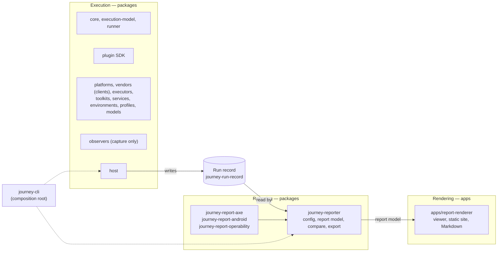

# Architecture: execution, run record, reporting, rendering

Journey Mesh keeps running journeys and reporting on them apart. They meet at
one boundary: the **run record** on disk.



| Layer | Packages | Knows about |
| --- | --- | --- |
| Execution | `journey-core`, `journey-execution-model`, `journey-runner`, `journey-plugin`, `journey-run-record`, `journey-platform-*`, `journey-vendor-*`, `journey-executor-*`, `journey-toolkit-*`, `journey-service-*`, `journey-observer-*`, `journey-environment-*`, `journey-profiles`, `journey-model-ujg`, `journey-host` | Plans, executions, evidence. Never reports. |
| Reporting | `journey-reporter`, `journey-report-*` | Run records and evidence formats. Never runtimes. |
| Rendering | `apps/report-renderer`, your templates | The report model. Never run records. How to present or publish it, including hosting limits. |
| Composition | `journey-cli`, `apps/*`, `examples/*` | Both sides; they wire them together. |

## Terms

| Term | Responsibility | Example |
| --- | --- | --- |
| **Runner** | Decides what runs and when: profiles, operation order, failure propagation. | `journey-runner` |
| **Platform** | Defines the typed contract that connects compatible clients and executors, and the platform's data types. It executes nothing. | `journey-platform-web`, `journey-platform-android` |
| **Vendor** | Groups the integrations of one software ecosystem: clients, environments, services. A distribution boundary, not an execution contract. | `journey-vendor-nextcloud` |
| **Client** | A deterministic, vendor-specific binding of a user-facing application on one platform: which entry target an operation opens and which value a transition enters. It is not the application and holds no automation session. | the Nextcloud Web client |
| **Executor** | Performs modeled operations with one automation technology: opens entries, performs transitions, asserts states, owns its sessions, and publishes an observation contract. | `journey-executor-playwright`, `journey-executor-appium` |
| **Toolkit** | Reusable infrastructure operations for a platform. No plugins, no vendors, no executors. | `journey-toolkit-android` (SDK, ADB, emulator, APK inspection) |
| **Service** | Provisions and releases infrastructure, and records what it provided. | `journey-service-android`, the Nextcloud stack |
| **Environment** | Manages a test's application fixtures and verifies modeled effects. | Nextcloud federated sharing |
| **Profile** | Selects which input modality performs each transition. | `journey-profiles` |
| **Journey observer** | Observes the runner's run and execution lifecycle. | `JourneyObserver` in `journey-runner` |
| **Executor observer** | Observes operations through a compatible executor, may contribute findings or policy failures. | Axe, UX, operability, Android accessibility |
| **Runtime observer** | Observes infrastructure events, independently of any executor session. | `journey-observer-docker` |
| **Report interpreter** | Turns recorded evidence into presentation-independent report data. Never runs anything. | `journey-report-axe` |

A suite selects an executor by name, the executor's client, and the executor
observers attached to it:

```yaml
executors:
  web:
    use: "@openuji/journey-executor-playwright/plugin"
    client:
      use: "@openuji/journey-vendor-nextcloud/web/plugin"
    observers:
      - use: "@openuji/journey-observer-axe/plugin"
runtimeObservers:
  - use: "@openuji/journey-observer-docker/plugin"
```

The host checks two contracts before it allocates anything, and they are
independent: the client must implement the executor's **client contract**
(`@openuji/journey-platform-web/client/v1`), and each executor observer must
implement the executor's **observation contract**
(`@openuji/playwright-observation/v1`). An observer written for Playwright is
not compatible with every Web executor.

## Rules

`pnpm lint` (`scripts/lint.mjs`) enforces them on every `package.json` and import,
dev dependencies and tests included.

Layers:

1. **Execution packages never depend on, or import, a reporting package.**
2. **Reporting packages never depend on the host, the CLI, platforms, toolkits,
   vendors, executors, environments, services, or observer capture code.** From
   an observer they import only its `./evidence` entry: the recorded evidence
   types and pure helpers.
3. **Only composition roots depend on both sides**: `journey-cli`, `apps/*` and
   `examples/*`.
4. **Nothing under `packages/` renders**: no `.tsx`, no React, no HTML.
5. **An observer's `./evidence` entry loads no browser or device runtime**
   (Playwright, axe-core, Appium, executors, platforms, toolkits, vendors).

Execution:

6. **Platforms depend on no toolkit, service, executor, vendor or observer.**
7. **Vendors depend on no executor or observer.** A client never imports the
   executor that runs it.
8. **Executors depend on no vendor.**
9. **Observers import an executor only through its `./observation` entry**, and
   that entry loads no browser or device runtime.
10. **`journey-runner` depends on no platform, vendor or executor.**
11. **Toolkits depend on no vendor, executor or observer.**

```
Nextcloud Web client   another vendor's Web client
         └──────────┬──────────┘
                    ▼
      journey-platform-web (client contract)
                    ▲
       journey-executor-playwright ◀─./observation── Axe, UX, operability observers

journey-platform-android ◀── journey-toolkit-android ◀── journey-service-android
```

## What each side owns

**Execution** decides the verdict. A test passes when its execution passed,
every journey observer output was valid, and no journey observer reported a policy error (for
example axe strict mode). The host writes the run record atomically; it has no
file-size policy, no reporters, and no journey-map validation. Observers return
only `{ id, kind, measurements, evidence, errors }`; the host keeps nothing else.

**Reporting** derives. Interpreters turn an observer's recorded evidence into
documents and per-step metrics; the reporter joins everything into the report
model. A failing interpreter or a broken journey map is a report error. It is
reported and never changes a verdict. `journey-mesh test` exits with code 3 when
the tests passed but the report could not be built at all.

**Rendering** reads the report model and evidence files, and is entirely the
app's business: formats, sites, hosting limits. The viewer, static site
publication and a Markdown summary live in `apps/report-renderer`; any other
stack can read the same JSON (see [report model](report-model.md)).

## Observation

Observation has three boundaries. Each has its own contract, and they are not
merged into one observer interface:

| Boundary | Contract | Owned by | Receives |
| --- | --- | --- | --- |
| Journey | `JourneyObserver` | `journey-runner` | Run and execution start and completion |
| Executor | `ExecutorObserverPlugin` + the executor's observation contract | `journey-plugin` (registration), the executor's `./observation` entry (payloads) | Operations, stages, locators, input decisions, through one executor |
| Runtime | `RuntimeObserverPlugin` + typed topics | `journey-plugin` (registration), a contract package on the producer side (topics) | Infrastructure lifecycle events, e.g. `journey-service-docker/observations` |

*Where* evidence is collected (the boundary) and *what* is measured (the
category) are independent:

| Category | Boundary |
| --- | --- |
| Accessibility | Executor (Playwright today, Appium for Android) |
| Interaction metrics, UX checkpoints | Executor |
| Performance | Executor or runtime, depending on the measurement |
| Reliability diagnostics, infrastructure logs | Runtime |
| Run lifecycle | Journey |

The component that produces an observation owns its contract; the observer that
records evidence owns its evidence schema (its `./evidence` entry, which report
interpreters read). An observer implements the contract of the boundary it
observes; it never defines that boundary. Observers do not control execution:
they own no session and start no interaction. A configured policy, such as
axe strict mode, may still fail a test through the observer's output errors.
Today's observation payloads still pass Playwright `Page`/`Locator` objects and
the full `AppiumSession`; narrowing them to read-only views is future work.

Effect verification is not observation: an executor observer may record that a
sharing control was activated, and the environment independently verifies that
the share exists.

## Extending

| You want to | Write | Where |
| --- | --- | --- |
| Support another application on an existing platform | a client plugin (`defineClientPlugin`) implementing the platform's client contract, usually with `@openuji/journey-plugin/client` for bindings | a vendor package |
| Provision an application stack with Docker Compose | a service plugin using `@openuji/journey-service-docker/compose`, with `prepare` and `bootstrap` hooks for your application | a vendor package |
| Prepare and verify application fixtures | an environment plugin (`defineEnvironmentPlugin`) | a vendor package |
| Drive a platform with another automation technology | an executor plugin (`defineExecutorPlugin`) that declares a client contract and publishes a pure `./observation` entry | `journey-executor-*` |
| Add a platform | a client contract and entry target types, nothing else | `journey-platform-*` |
| Capture new evidence | an executor observer plugin (`defineExecutorObserverPlugin`) importing the executor's `./observation` entry, with a types-only `./evidence` entry | execution |
| Capture infrastructure diagnostics | a runtime observer plugin (`defineRuntimeObserverPlugin`) subscribing to typed lifecycle topics | execution |
| Turn that evidence into report data | an interpreter module exporting `journeyMeshInterpreter` (`defineInterpreter`) | reporting |
| Show it | a view keyed by the data's `format` in `apps/report-renderer/src/providers`, or your own template | rendering |

A vendor may support only some platforms. None of these changes the runner or
an existing executor: a second vendor's Web client composes with the Playwright
executor through `webClientContract` alone (see
`packages/journey-host/test/second-vendor.test.ts`).

## Configuration and resource ownership

Preparation holds immutable configuration, compiled plans and plugin recipes.
Parsing and operation validation are pure; they see neither runtime input values
nor an artifact writer. The host resolves service-output references into deeply
frozen constructor records for executors and services. Clients and observers do not
share an input accessor. Runtime instances and evidence stores belong to one run.

Infrastructure effects start at `JourneyService.start`, which returns outputs,
a provenance snapshot and a release handle. Producers compensate partial failure;
the host registers returned handles before checking output contracts. Resource
owners distinguish acquisitions from borrowed resources. Explicit CLI shutdown
uses persisted ownership separately from automatic release. Android build and
installation evidence stay in the Android packages; the host and reporting layers
contain no Android-specific branches. See [service composition](service-composition.md).

## Runtime observation

Infrastructure diagnostics use a run-scoped observable, separate from journey
assessment observers. Producers publish typed topic values with a component
source and timestamp. Subscribers receive detached, immutable snapshots. Delivery
is awaited and bounded so a resource owner can publish `before-release` before
its data disappears. The bound belongs to the owner: a subscriber's `timeoutMs`
is capped by the suite's `runtimeObserverTimeoutMs` (default 30 seconds), so no
observer can hold back disposal longer than the suite allows. Subscriber errors
and timeouts cannot prevent disposal or change a journey verdict; the host
records them in `diagnostics/errors.json`.

Suite `runtimeObservers` select `defineRuntimeObserverPlugin` implementations.
Preflight parses their settings without constructing them. The host constructs
fresh subscribers and evidence stores before services start, closes them after
service cleanup, and includes their registered artifacts in the run record. No
observable, subscription, or runtime publisher is shared across runs or passed
to configuration parsers. The observable is a host implementation, not part of
the plugin SDK. Every runtime plugin context carries one publisher port,
`context.observations`; it publishes to no one outside a suite run, such as
`services up`. Runtime observers receive a frozen, subscribe-only source; no
plugin receives the subscriber registry, the publisher factory, or `close`.

Topic contracts belong to the producing side's infrastructure boundary:
`journey-service-docker/observations` defines Compose lifecycle data without
collectors or application knowledge, and `journey-service-docker/compose`
publishes it for any stack it starts. The Nextcloud stack is one such stack; it
does not choose or read diagnostic logs. `journey-observer-docker` consumes the
same events from any Compose producer and captures configured container output
and files. The example's `mesh.yaml` chooses the Nextcloud log path. The host
knows neither Docker nor Nextcloud, and runtime connection metadata is never
copied into provenance or the run record.

## Persisted names

Run records store the name of the executor that ran each operation. Format
version 2 calls it `executor`; version 1 called it `adapter`, and the reader
normalizes version-1 records in memory (see [run record](run-record.md)). Plugin
kinds, configuration keys and contract identifiers are not persisted. The old
configuration keys (`adapters:`, `adapter:`, `driver:`) and plugin kinds
(`driver`, `adapter`, `observer`) are rejected with an error that names the
replacement.
