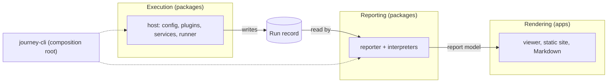

# Architecture

This document holds only the structure of Journey Mesh and the invariants that
keep it in shape. APIs, options and file formats are documented by their code
(see [Where the details are](#where-the-details-are)).

Running journeys and reporting on them are separate layers. They meet at one
boundary, the **run record** on disk.

| Layer | Packages | Knows about |
| --- | --- | --- |
| Execution | `journey-core`, `-execution-model`, `-runner`, `-plugin`, `-run-record`, `-profiles`, `-model-*`, `-host`, `-platform-*`, `-vendor-*`, `-executor-*`, `-toolkit-*`, `-service-*`, `-observer-*`, `-environment-*` | Plans, executions, evidence. Never reports. |
| Reporting | `journey-reporter`, `journey-report-*` | Run records and evidence formats. Never runtimes. |
| Rendering | `apps/*` | The report model. Never run records. |
| Composition | `journey-cli`, `apps/*`, `examples/*` | Both sides; they wire them together. |

`journey-run-record` is classified as execution, but its types and readers are
the boundary contract that reporting reads.

## Roles

| Role | Responsibility |
| --- | --- |
| Model binding | Turns a journey description (UJG JSON-LD) into a `JourneyPlan` |
| Runner | Decides what runs and when: profiles, operation order, failure propagation |
| Profile | Selects the input modality that performs each transition |
| Platform | Defines the client contract that connects clients and executors of one platform; executes nothing |
| Vendor | Groups one ecosystem's clients, environments and services; a distribution boundary |
| Client | Resolves an application's entry targets and transition values for one platform; holds no session |
| Executor | Performs operations with one automation technology, owns its sessions, publishes an observation contract |
| Toolkit | Reusable infrastructure operations for a platform; no plugins |
| Service | Provisions and releases infrastructure, and records what it provided |
| Environment | Sets up a test's fixtures and verifies modeled effects |
| Journey observer | Observes the runner's run and execution lifecycle |
| Executor observer | Collects evidence through an executor's observation contract |
| Runtime observer | Collects infrastructure diagnostics from typed lifecycle topics |
| Report interpreter | Turns one observer's recorded evidence into report data |

## Invariants

### Dependencies

Enforced by `pnpm lint` ([`scripts/lint.mjs`](../scripts/lint.mjs)) on every
manifest and import, dev dependencies and tests included.

1. Execution packages never depend on, or import, a reporting package.
2. Reporting packages never depend on the host, the CLI, platforms, toolkits,
   vendors, executors, environments, services, or observer capture code. From an
   observer they import only its `./evidence` entry.
3. Only composition roots depend on both sides.
4. Nothing under `packages/` renders: no `.tsx`, no React, no HTML.
5. An observer's `./evidence` entry loads no browser or device runtime.
6. Platforms depend on no toolkit, service, executor, vendor or observer.
7. Vendors depend on no executor or observer.
8. Executors depend on no vendor.
9. Observers import an executor only through its `./observation` entry, which
   loads no browser or device runtime.
10. `journey-runner` depends on no platform, vendor or executor.
11. Toolkits depend on no vendor, executor or observer.

Consequence: a second vendor's client composes with an existing executor
through the platform's client contract alone, without changing the runner or
the executor ([`second-vendor.test.ts`](../packages/journey-host/test/second-vendor.test.ts)).

### Execution

- **Preflight before effects.** Every selected test is loaded, compiled and
  assembled before any service starts: plugin kinds, client contracts,
  observation contracts, service input references and profile selections are
  checked first. `validate` never starts a service. A broken test leaves no
  fixtures or services behind.
- **Pure preparation.** Plugin `parse` and `create` allocate no automation
  resources and mutate no services. Each run gets fresh runtime instances and
  evidence stores; nothing runtime is shared across runs.
- **Sequential runner.** Profiles and operations run in order. A failed
  operation stops its profile; executor cleanup and environment teardown still
  run, and their failures are kept next to the original one.
- **Portable runner.** The runner never sees services, and its main entry loads
  no Node built-in or automation runtime
  ([`runner-portability.mjs`](../packages/journey-runner/test/runner-portability.mjs)).
- **The model is the script.** A model binding lowers into the runner's existing
  operation kinds; unsupported source features fail explicitly. Executors
  perform what the model declares and never invent a path, step or locator.
- **Observers only observe.** They own no session and start no interaction.
  They affect a verdict only through `errors` in their output (for example a
  strict accessibility policy).
- **Effects are verified by the environment**, not by observers, and effect
  checks never mutate the application.
- **Services own their effects.** Effects start at `start()`, which returns
  outputs, provenance and a release handle. The host registers the handle
  before validating outputs and releases handles in reverse order, also after
  failure or cancellation. A service compensates its own partial acquisition,
  and automatic release frees only what was acquired, never borrowed resources.
- **Diagnostics never decide.** Runtime observer failures and timeouts are
  recorded as diagnostics; they cannot change a verdict or hold back disposal
  longer than the suite's `runtimeObserverTimeoutMs`.
- **No secrets on disk.** Provenance and the run record carry no credentials,
  and no runtime paths or connection metadata.

### Run record

- The host writes it atomically, once per run: JSON plus the evidence files
  components registered. No presentation data, size policy or chunking.
- **One verdict rule**, `testPassed` in
  [`verdict.ts`](../packages/journey-run-record/src/verdict.ts): execution
  passed, no invalid observer output, no observer errors. Nothing downstream
  changes it.
- Every `href` is a relative path inside the run directory; readers reject
  references that escape it, including through symlinks. A run directory can be
  moved or published as is.
- Older format versions are normalized on read; consumers only see the current
  version.

### Reporting and rendering

- Reporting reads a run record and nothing else, and executes nothing. A
  failing interpreter or broken journey map is a report error and never changes
  a verdict.
- `compare` is reporting over two run directories: it executes nothing and
  pairs executions by test and profile ID unless pairings are given. Numeric
  deltas require the same metric identity, method, unit and aggregation.
- Rendering reads the report model and evidence files, never run records.
  Publication concerns (static sites, file-size limits, splitting) belong to the
  app; run directories are never split.
- `journey-mesh test` exits 0 when all tests passed, 1 when one failed, 2 on a
  configuration error, and 3 when the tests passed but the report could not be
  built.

## Where the details are

| Topic | Source of truth |
| --- | --- |
| CLI | `journey-mesh --help` |
| Suite configuration | [`journey-host/src/config/schema.ts`](../packages/journey-host/src/config/schema.ts) |
| Plugin kinds and contracts | [`journey-plugin/src/plugins.ts`](../packages/journey-plugin/src/plugins.ts) |
| Run record format | [`journey-run-record/src/types.ts`](../packages/journey-run-record/src/types.ts), [`paths.ts`](../packages/journey-run-record/src/paths.ts) |
| Report model | [`report-model.schema.json`](../packages/journey-reporter/schema/report-model.schema.json) (generated; a test fails when stale) |
| Working compositions | [`examples/`](../examples) |
