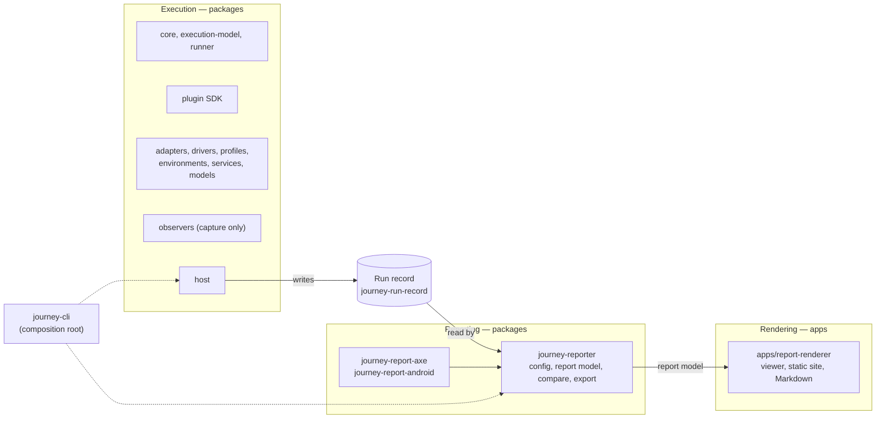

# Architecture: execution, run record, reporting, rendering

Journey Mesh keeps running journeys and reporting on them apart. They meet at
one boundary: the **run record** on disk.

| Layer | Packages | Knows about |
| --- | --- | --- |
| Execution | `journey-core`, `journey-execution-model`, `journey-runner`, `journey-plugin`, `journey-run-record`, adapters, drivers, observers, environments, services, profiles, `journey-model-ujg`, `journey-host` | Plans, executions, evidence. Never reports. |
| Reporting | `journey-reporter`, `journey-report-*` | Run records and evidence formats. Never runtimes. |
| Rendering | `apps/report-renderer`, your templates | The report model. Never run records. How to present or publish it, including hosting limits. |
| Composition | `journey-cli`, `apps/*`, `examples/*` | Both sides; they wire them together. |

## Rules

`pnpm lint` (`scripts/lint.mjs`) enforces them on every `package.json` and import:

1. **Execution packages never depend on, or import, a reporting package**, not
   even in dev dependencies or tests.
2. **Reporting packages never depend on the host, the CLI, adapters, drivers,
   environments, services, or observer capture code.** From an observer they
   import only its `./evidence` entry: the recorded evidence types and pure
   helpers.
3. **Only composition roots depend on both sides**: `journey-cli`, `apps/*` and
   `examples/*`.
4. **Nothing under `packages/` renders**: no `.tsx`, no React, no HTML.
5. **An observer's `./evidence` entry loads no browser or device runtime**
   (Playwright, axe-core, Appium, adapters, drivers) at runtime.

## What each side owns

**Execution** decides the verdict. A test passes when its execution passed,
every observer output was valid, and no observer reported a policy error (for
example axe strict mode). The host writes the run record atomically; it has no
file-size policy, no reporters, and no journey-map validation. Observers return
only `{ id, kind, measurements, evidence, errors }`; the host keeps nothing else.

**Reporting** derives. Interpreters turn an observer's recorded evidence into
documents and per-step metrics; the reporter joins everything into the report
model. A failing interpreter or a broken journey map is a report error. It is
reported and never changes a verdict. `journey-mesh test` exits with code 3 when
the tests passed but the report could not be built at all.

**Rendering** reads the report model and evidence files, and is entirely the
app's business: formats, sites, hosting limits. The viewer, static site
publication and a Markdown summary live in `apps/report-renderer`; any other
stack can read the same JSON (see [report model](report-model.md)).

## Extending

| You want to | Write | Where |
| --- | --- | --- |
| Capture new evidence | an observer plugin (`defineObserverPlugin`) with a types-only `./evidence` entry | execution |
| Turn that evidence into report data | an interpreter module exporting `journeyMeshInterpreter` (`defineInterpreter`) | reporting |
| Show it | a view keyed by the data's `format` in `apps/report-renderer/src/providers`, or your own template | rendering |

## Configuration and resource ownership

Preparation holds immutable configuration, compiled plans and plugin recipes.
Parsing and operation validation are pure; they see neither runtime input values
nor an artifact writer. The host resolves service-output references into deeply
frozen constructor records for adapters and services. Drivers and observers do not
share an input accessor. Runtime instances and evidence stores belong to one run.

Infrastructure effects start at `JourneyService.start`, which returns outputs,
a provenance snapshot and a release handle. Producers compensate partial failure;
the host registers returned handles before checking output contracts. Resource
owners distinguish acquisitions from borrowed resources. Explicit CLI shutdown
uses persisted ownership separately from automatic release. Android build and
installation evidence stay in the Android packages; the host and reporting layers
contain no Android-specific branches. See [service composition](service-composition.md).
