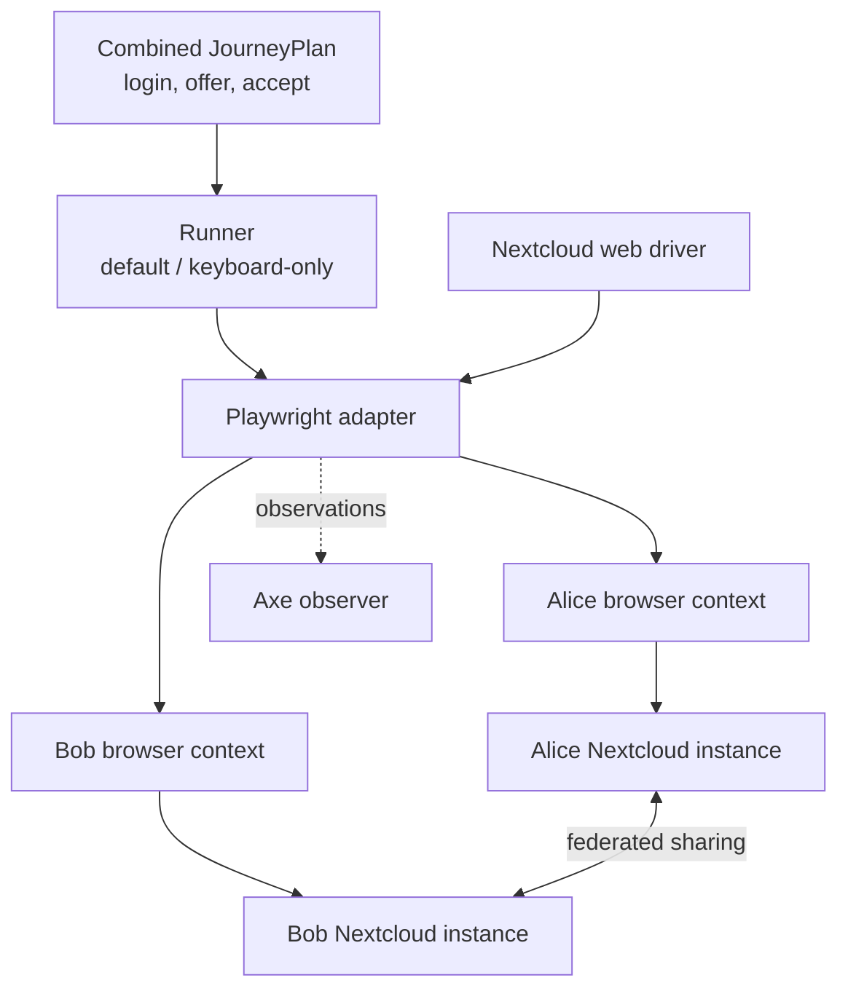
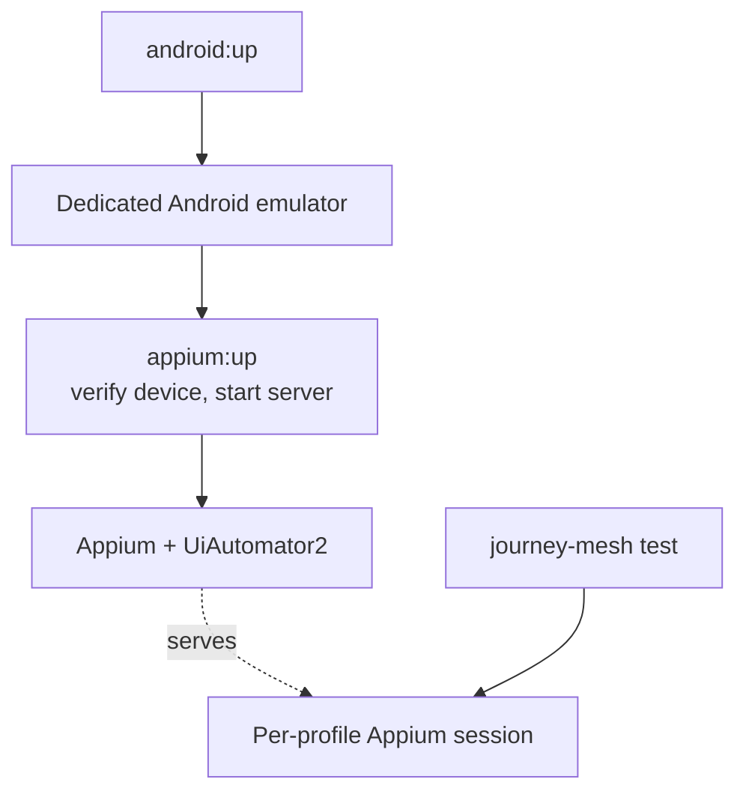
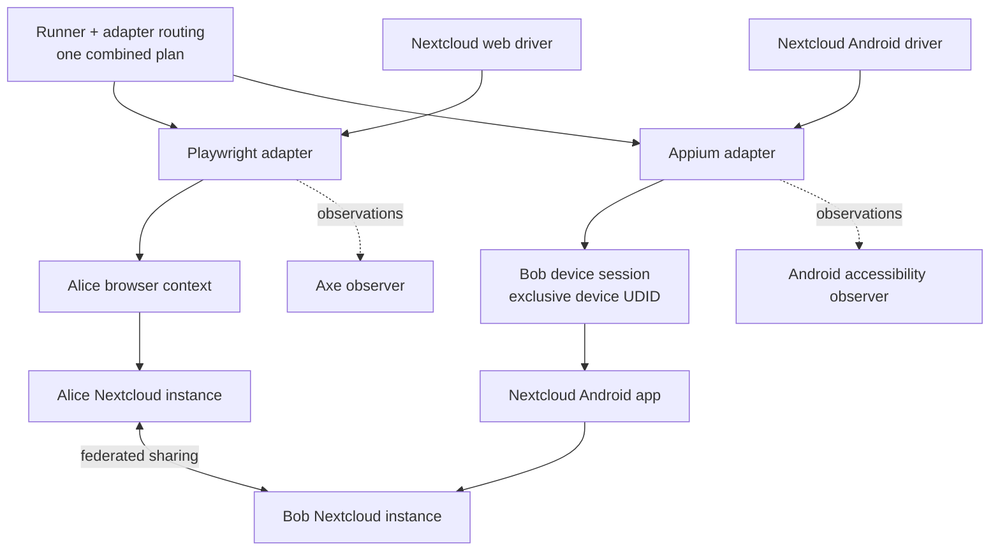
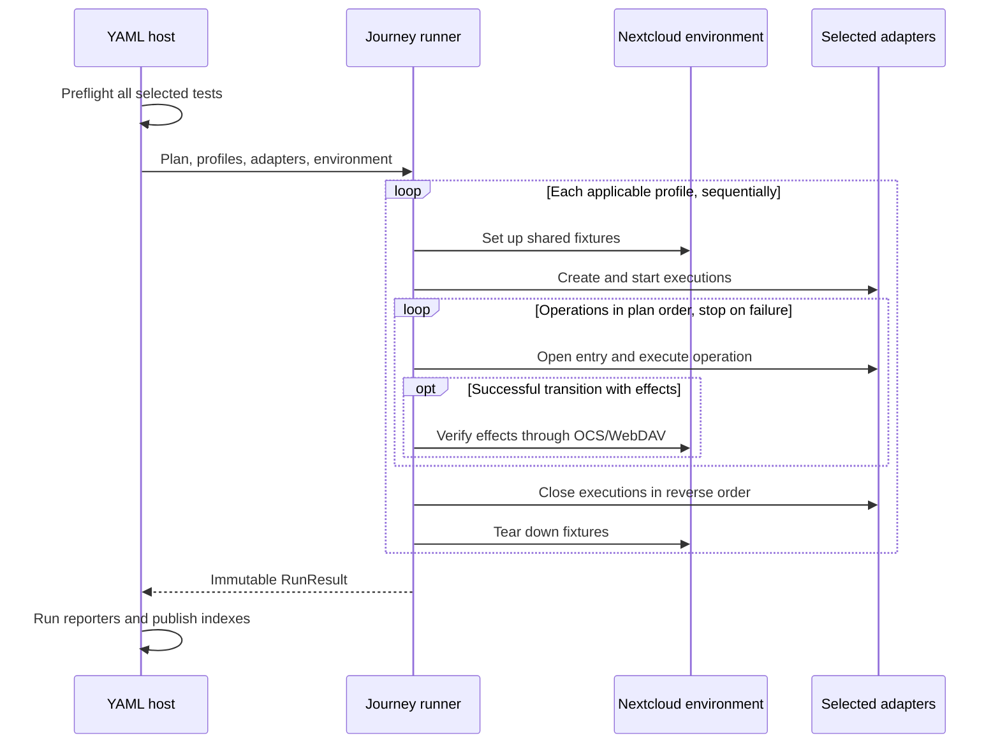
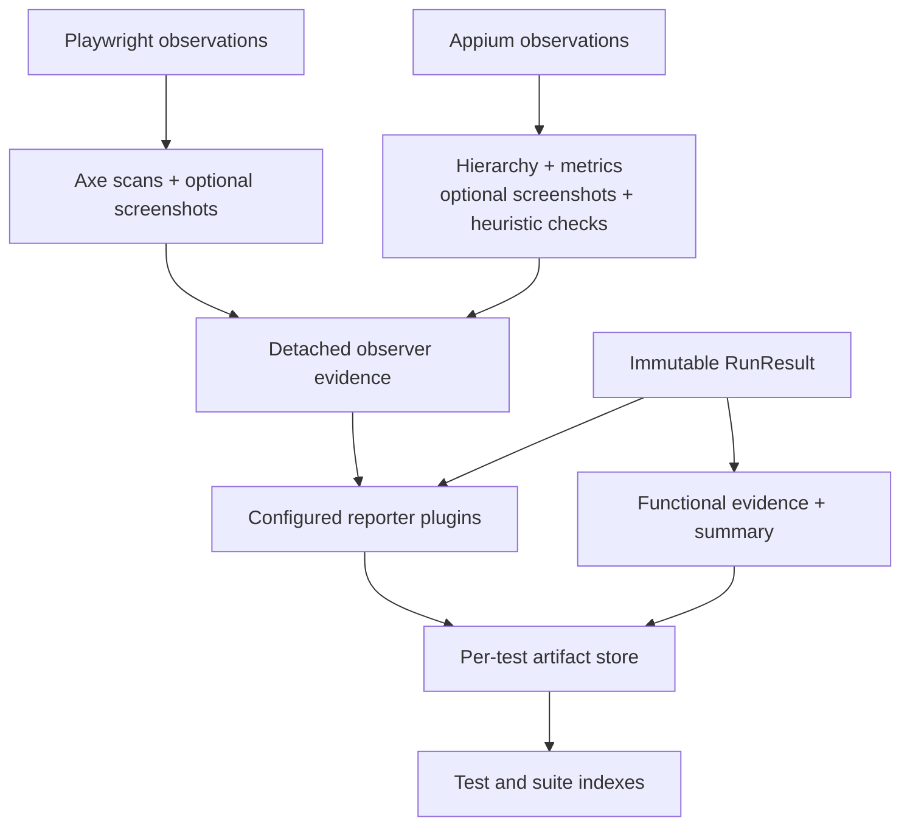

[](https://github.com/openuji/journey-mesh/actions/workflows/example-ci.yml)

# Nextcloud file-sharing tests

For the versioned acceptance comparison against Nextcloud PR #66147, including
UX measurements and GitHub Pages publication, see the
[configured comparison](#compare-independent-deployments).

Two compositions of the [Journey Mesh architecture](../../README.md#architecture)
exercise the same federated file-sharing scenario. The tools and prerequisites
below belong to this example's selected components.

[`mesh.yaml`](./mesh.yaml) defines the tests, their selected journeys,
adapters, drivers, observers, interaction profiles, credentials, and output.
The same Journey Mesh command executes any configured runtime combination.

- [`browser-sharing`](#run-the-browser-test): Alice and Bob use the web adapter,
  with default and keyboard-only profile combinations.
- [`native-recipient-sharing`](#run-the-native-recipient-test): Alice uses the
  web adapter and Bob uses Appium, with default-web/touch-Android and
  keyboard-web/touch-Android combinations.

Each test first executes explicit Alice and Bob login setup journeys, whose
operations use `urn:phase:setup`, followed by Alice's offer and Bob's acceptance
journeys. Accessibility observers journal setup operations as not applicable
without taking screenshots or auditing them.
Each test has one shared fixture lifecycle per profile and one report. Native
bindings come from the checked-in Android model; runtime selection does not
rewrite them.

## One-time prerequisites

Run the commands in this guide from `examples/nextcloud-filesharing` unless a
repository-root path is shown. Install Node 22.22.2 or newer in the Node 22 line,
pnpm, Docker with Compose, and the workspace dependencies:

```sh
pnpm install --frozen-lockfile
pnpm build
```

The web adapter installs its own pinned Chromium build automatically, the
first time any browser-based test launches one; there is no separate install
step. On Linux, if that first launch fails because Chromium can't start,
install its system dependencies once with
`pnpm --filter @openuji/journey-adapter-playwright exec playwright install --with-deps chromium`.

Native execution additionally requires a current Android Studio installation and
an `ANDROID_HOME` (or `ANDROID_SDK_ROOT`) pointing at its SDK. The lifecycle
command uses Android Studio's bundled Java and Android CLI when standalone SDK
tools are absent. Linux hosts need working KVM access. Local native execution is
supported on Apple Silicon and Intel macOS, and x86-64 Linux.

## Start the Nextcloud stack

The stack lifecycle owns Docker and the canonical service URLs:

```sh
pnpm stack:up
pnpm stack:provision
pnpm stack:seed
```

`stack:up` starts only the containers and preserves `host.docker.internal` for
web runs, then writes the effective configuration to `.runtime/stack.env`.
For Android, use `pnpm stack:up:android` instead: it discovers a host IPv4 address
reachable from the device and Docker containers. Provisioning creates the users and
federation configuration; seeding uploads `report.pdf` for Alice.

Set `NEXTCLOUD_STACK_HOST` to a reachable IPv4 address before `stack:up` to
override discovery. `NEXTCLOUD_STACK_ENV_FILE` can select a complete custom
environment file. Later stack commands reuse the generated runtime environment.

## Run the browser test

Both participants use one configured Playwright adapter. For each profile, the
runner executes the combined plan using a new adapter execution, with isolated
browser contexts and pages per actor/touchpoint. The Nextcloud web driver
resolves entry URLs and text values. The axe observer collects evidence through
Playwright's observation contract.



Execution stays entirely in the YAML test specification:

```sh
pnpm exec journey-mesh validate mesh.yaml --test browser-sharing
pnpm exec journey-mesh test mesh.yaml --test browser-sharing
```

The test runs both its default and keyboard-only profiles. Set `HEADLESS=false`
to watch the browsers. `AXE_STRICT=true` enables the browser accessibility
observer's reporting failure policy.

## Start the optional native services

Android and Appium have separate lifecycles:

```sh
pnpm android:up
pnpm appium:up
```

`android:up` runs the `@openuji/journey-driver-android/service` plugin, installs
missing platform tools, emulator, command-line tools, and the host-native
Google APIs API 35 image. It creates or validates the dedicated Pixel 6 AVD
`journey-mesh-api35`, boots headlessly, disables animations, and writes the
active device ID to `.runtime/android.env`. The first run downloads several
large components and may show Android SDK license prompts. An existing AVD
with the same name is reused only when its API, image architecture, and
device profile match the pins. These device pins — `api`, `avd`, `image`,
`localImages`, `profile`, `locale`, `requiredPackages` — live directly in
`mesh.yaml`'s `services.android.options`; there is no separate manifest file.

`appium:up` runs the `@openuji/journey-adapter-appium/service` plugin, verifies that
device, installs the pinned UiAutomator2 driver into a versioned repository
cache, starts Appium on port 4723, waits for readiness, and writes
`.runtime/appium.env`. It neither starts Nextcloud nor runs a journey — nor
does it download the Nextcloud APK; the Appium adapter does that when its first
execution starts (same as Chromium
for the web adapter — see "One-time prerequisites" above), from the `application`
block already declared in `adapters.android.options`. Appium logs are stored
under `.tmp/appium-runtime/`; emulator logs are under `.tmp/android-runtime/`.

The native infrastructure is prepared separately from per-profile execution:



The service commands own the emulator and server processes. The adapter owns
the test session, application state, and its cleanup; ending a profile does not
stop the infrastructure. Validation never downloads anything; the checksum-pinned
APK cache is populated when the first native execution starts.

Both `android:up` and `appium:up` are the generic
`journey-mesh services up mesh.yaml --service <key>` command underneath —
`pnpm android:up`/`pnpm appium:up` are just this example's own thin script
names for `--service android`/`--service appium`. Overrides go through
`mesh.yaml`'s `services.<key>.options` (interpolated the same way as every
other option in this file), not CLI flags:

```yaml
services:
  android:
    options:
      avd: '${ANDROID_AVD_NAME:-journey-mesh-api35}'
      # api, image, localImages, profile, locale, requiredPackages also live here
  appium:
    options:
      port: '${APPIUM_PORT:-4723}'
```

So `ANDROID_AVD_NAME=another-dedicated-avd pnpm android:up` and
`APPIUM_PORT=4725 pnpm appium:up` override without editing the YAML.
`ANDROID_CLI`, `ANDROID_STUDIO_HOME`, and `APPIUM_HOME` provide further
environment-level overrides read directly by the service, same as before.
Global Appium installations are never modified.

## Run the native-recipient test

Alice's setup and offer journeys route to Playwright; Bob's setup and acceptance
journeys route to Appium. Routing follows each journey item's configured
`adapter`: every operation carries its journey item as its `segment`, so one combined plan retains the order and source references across
both adapters. Profiles combine Alice's default or keyboard-only interaction
with Bob's touch interaction.



Both drivers are deterministic entry/value resolvers; browser and device
resources belong to their adapters. The Android model supplies native locators
and application entry bindings. Selecting an adapter does not translate web
locators into native ones. See the [native journey model](ujg/filesharing.android.ujg.jsonld)
and [Android driver](../../packages/journey-driver-nextcloud/src/android.ts).

With the stack, Android, and Appium ready, the execution command still selects
only the YAML test:

```sh
pnpm exec journey-mesh validate mesh.yaml --test native-recipient-sharing
pnpm exec journey-mesh test mesh.yaml --test native-recipient-sharing
```

This runs `default-web-touch-android` and
`keyboard-only-web-touch-android`. Set `ANDROID_A11Y_STRICT=true` to enable the
native accessibility observer's reporting failure policy. Omitting `--test`
selects both configured tests and therefore requires both the web and the native services.

From the repository root, the same selections are:

```sh
pnpm exec journey-mesh test examples/nextcloud-filesharing/mesh.yaml --test browser-sharing
pnpm exec journey-mesh test examples/nextcloud-filesharing/mesh.yaml --test native-recipient-sharing
```

## Stop local services

Stop the optional native services in reverse order:

```sh
pnpm appium:down
pnpm android:down
```

These commands stop only the processes recorded for this example. They retain
the AVD, Android SDK packages, APK, Appium cache, reports, and Nextcloud data.
`ANDROID_AVD_NAME=another-dedicated-avd pnpm android:down` stops a named override.

To delete the Nextcloud containers and their service volumes, run:

```sh
pnpm stack:reset
```

This is a destructive backend reset; reports and Android assets are retained.
See [native execution](#run-the-native-recipient-test) for the bindings and
[evidence and reports](#evidence-and-reports) for evidence limits and review
status. The CI-only
[`run-ci.sh`](../../.github/workflows/run-ci.sh) helper, beside the Android
workflow it belongs to, continues to own its temporary Appium and logcat
processes.

## Configuration and lifecycle

The [configuration schema](../../packages/journey-host/src/config/schema.ts) and
[plugin contracts](../../packages/journey-plugin/src/plugins.ts) define the YAML
host's interfaces. In this example, `model` selects the UJG compiler, `adapters`
declare drivers and observers, and each test declares ordered journey items,
profile assignments, and a shared environment. `envFiles` supply configuration
values, `outputDir` selects the report root, and `services` declare optional
infrastructure lifecycles. Changing journey and adapter selections changes where
execution runs; there are no platform-specific runner files.

`@openuji/journey-driver-nextcloud/federated-sharing/plugin` owns fixture cleanup,
fixture creation, and OCS/WebDAV effect checks. This example supplies only the
service/account values, fixture path/name, and journey effect IDs in YAML. UI
entry routes and transition values are likewise YAML data interpreted by driver
plugins.

All selected tests preflight before fixtures are modified: model compilation,
plugin compatibility, adapter support, and profile applicability/input selection
are checked first. Only referenced adapters and their dependencies are loaded,
so selecting the browser test does not require the Android configuration.



Each applicable profile sets up shared fixtures once and executes its configured
journeys in order. The first operation failure stops that profile; partial
adapter startup still triggers cleanup. Cleanup failures are retained alongside
the original failure, and fixture teardown also runs after a failed setup.
Cancellation closes active automation resources and is propagated to environment
requests.

## Evidence and reports

The web observer captures axe scans and optional source screenshots. The native
observer captures a redacted UI hierarchy, device metrics, optional screenshots,
and heuristic accessibility checks. Observers collect evidence at adapter stages
such as state assertion and transition readiness, retain detached evidence, and
provide detached outputs after execution. The host saves them in the result
bundle. The report opens on the journey map, drawn from the same `ujg/*.ujg.jsonld`
documents that are executed, with outcomes and accessibility metrics on every
state. Open `test-results/index.html` directly or serve it with `pnpm e2e:report`. The axe and Android reporters write the
detailed standalone reports linked below the map.



The host collects observer outputs and invokes independently configured reporters sequentially.
Reporting errors do not rewrite `RunResult`; the configured suite succeeds only
when execution passes and reporting has no errors. Accessibility strict modes
record policy errors in observer outputs. Evidence-collection errors during
execution can fail the operation itself.

From the repository root:

```sh
pnpm exec journey-mesh report examples/nextcloud-filesharing/test-results
```

The report root contains `index.html` and `bundle.json`. Each test has a
subdirectory, such as `test-results/browser-sharing/`, containing:

- `bundle.json`: compiled plan, immutable functional outcomes, observer outputs,
  measurements, reporting errors, and artifact descriptors.
- `index.html`: test summary and links to observer artifacts.
- Axe path HTML/JSON, accessibility summaries, and source screenshots.
- For native execution: hierarchy evidence, screenshots, device metrics,
  accessibility HTML/JSON, and APK/runtime metadata.

Reports are standalone files and do not require Playwright Test. Accessibility
findings support review; they do not establish WCAG or TalkBack conformance.
Native checks use the captured hierarchy and metrics; they do not exercise
TalkBack navigation or prove what a screen reader announces. Setup operations
are explicitly excluded from accessibility capture, so evidence covers the
selected sharing operations rather than every screen encountered during login.
Both native-recipient profiles have passed locally on API 35 arm64.
The API 35 x86_64 CI target requires its own successful workflow run.

## Compare independent deployments

```sh
pnpm comparison:validate   # preflight both subjects before either stack starts
pnpm comparison:run        # test nc34, test pr66147, then compare the saved bundles
pnpm comparison:report     # serve the comparison report
```

`comparison/nc34.mesh.yaml` and `comparison/pr66147.mesh.yaml` are ordinary
suites. Each owns its `label`, deployment pins, fixtures, journeys, UX recipes,
reporters and output directory, and lists the pinned Nextcloud stack under
`services`. The stack service builds and verifies the configured deployment,
provisions accounts, and records installed identities as provenance. Managed
stacks and their volumes are removed after execution; artifacts remain. The
ordinary browser/native example continues to use externally prepared services.

The comparison itself is `journey-mesh compare test-results/nc34/bundle.json
test-results/pr66147/bundle.json`. It loads no plugins and runs nothing: it copies
each subject's registered evidence below `test-results/comparison/subjects/`,
pairs the executions by their equal test and profile IDs, and publishes
`test-results/comparison/` with the report viewer. Both subjects' journey maps
appear together, each with node metrics and a link to that subject's full report
(`subjects/<side>/`); scenario and profile controls switch both, and the
measurement table shows candidate minus baseline. On narrow screens the maps
switch to the vertical layout. The selected JSON-LD journeys are checked-in scenario data referenced by
each mesh; there is no comparison-specific model generator or report
application. Findings and measured values come from the result bundles.

To inspect the report:

```sh
pnpm comparison:report
```

The publishing workflow uploads this same directory. All evidence links are
relative and the bundle contains no local paths, so it works under a project
URL. Serve the directory with the report command so the viewer can load its
saved JSON and assets. Comparison outputs from earlier versions use an obsolete
contract and must be regenerated.
