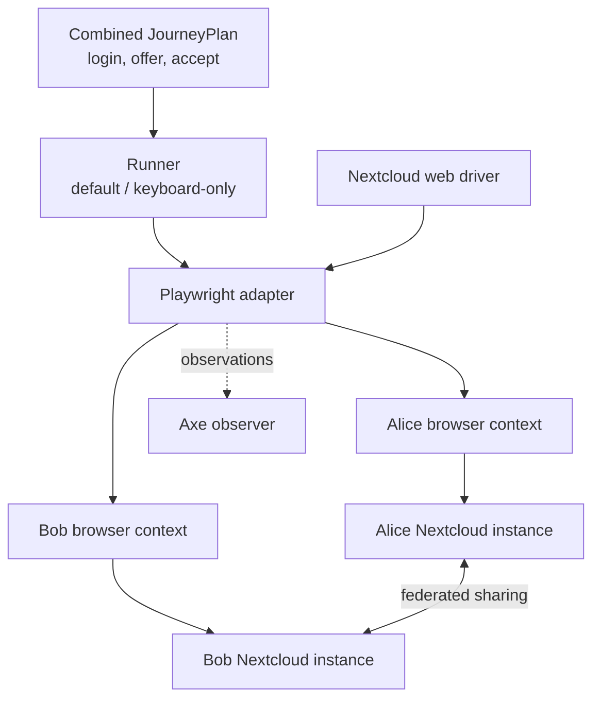
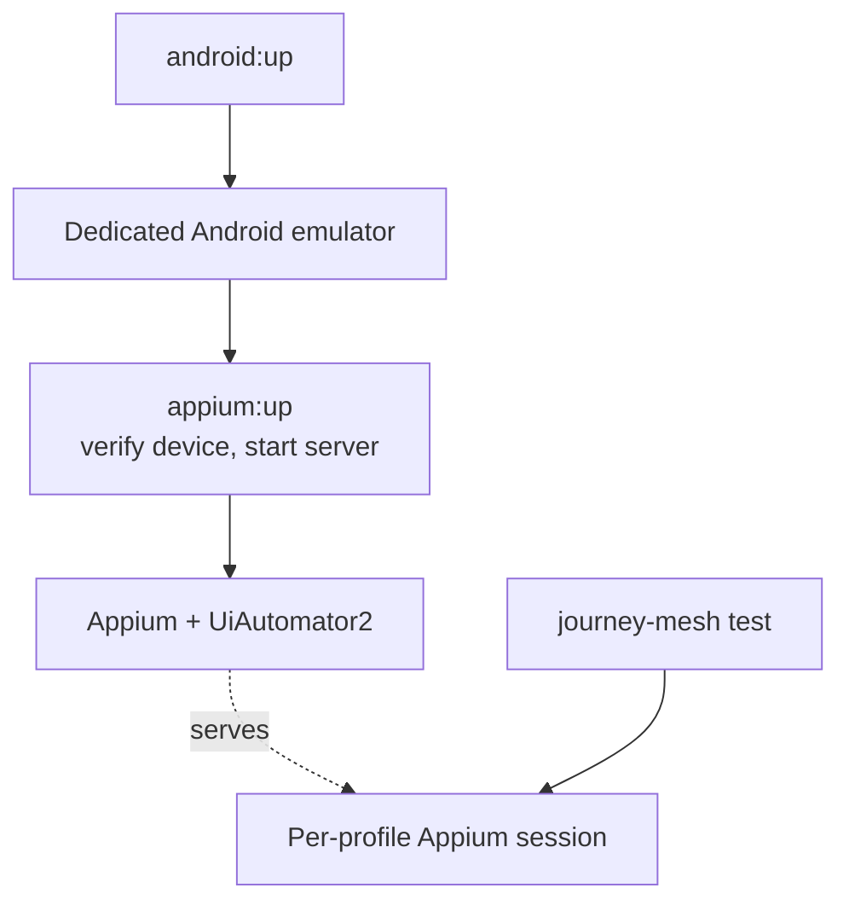
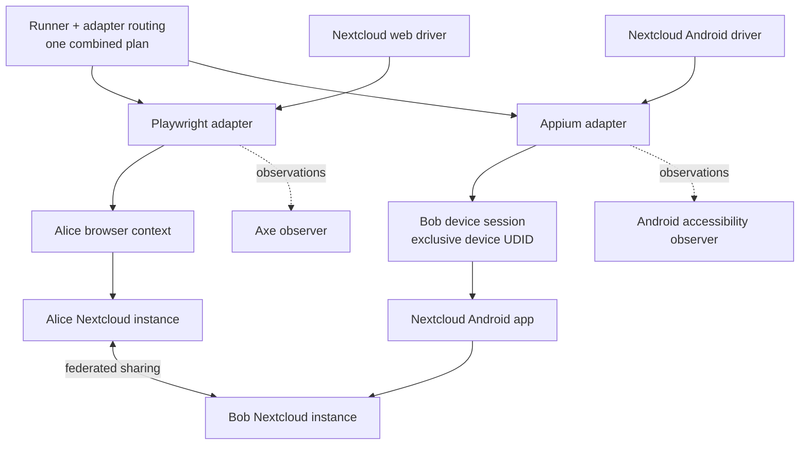
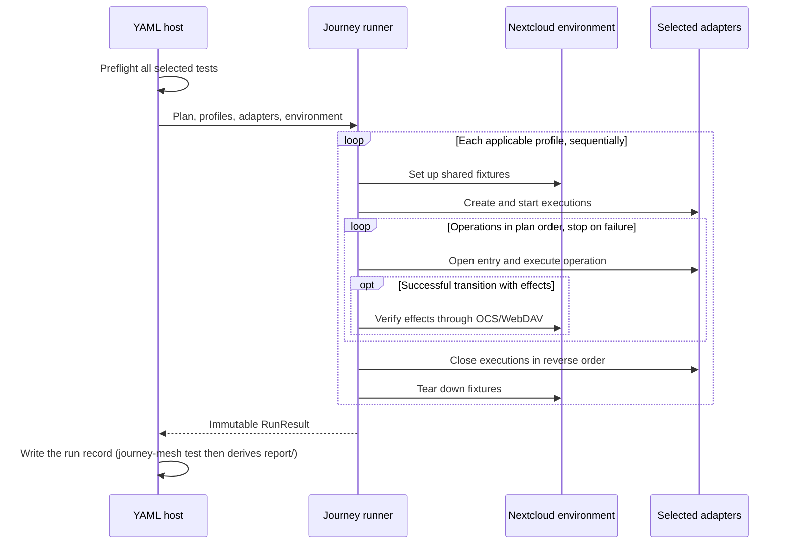
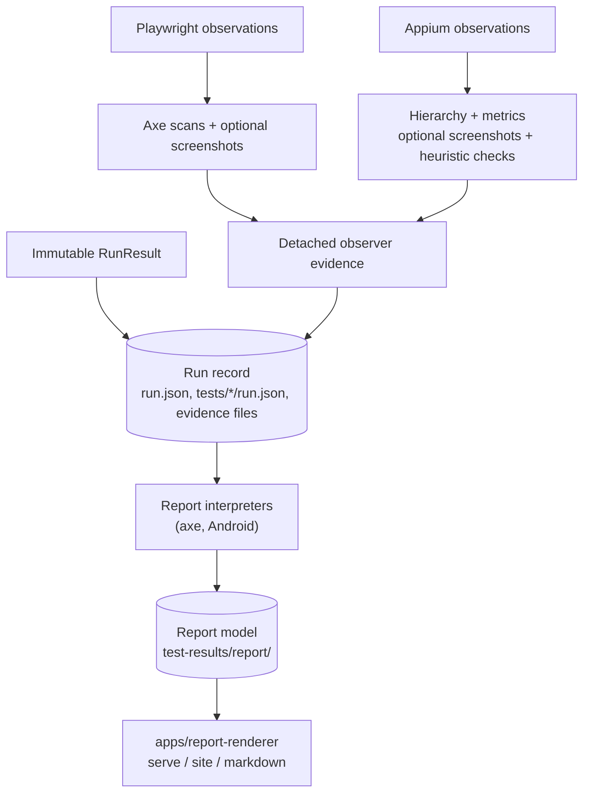

[](https://github.com/openuji/journey-mesh/actions/workflows/example-ci.yml)

# Nextcloud file-sharing tests

Two compositions of the [Journey Mesh architecture](../../README.md#architecture)
exercise the same federated file-sharing scenario. The tools and prerequisites
below belong to this example's selected components.

For further examples of Journey Mesh in use, such as checking an open Nextcloud
pull request from a separate repository, see
[journey-checks](https://github.com/openuji/journey-checks).

[`mesh.yaml`](./mesh.yaml) defines the tests, their selected journeys,
adapters, drivers, observers, interaction profiles, credentials, and output.
The same Journey Mesh command executes any configured runtime combination.

- [`browser-sharing`](#run-the-browser-test): Alice and Bob use the web adapter,
  with default and keyboard-only profile combinations.
- [`native-recipient-sharing`](#run-the-native-recipient-test): Alice uses the
  web adapter and Bob uses Appium, with default-web/touch-Android and
  keyboard-web/touch-Android combinations.

Each test first executes explicit Alice and Bob login setup journeys, whose
operations use `urn:phase:setup`, followed by Alice's offer and Bob's acceptance
journeys. Accessibility observers journal setup operations as not applicable
without taking screenshots or auditing them.
Each test has one shared fixture lifecycle per profile and one test record. Native
bindings come from the checked-in Android model; runtime selection does not
rewrite them.

## One-time prerequisites

Run the commands in this guide from `examples/nextcloud-filesharing` unless a
repository-root path is shown. Install Node 22.22.2 or newer in the Node 22 line,
pnpm, Docker with Compose, and the workspace dependencies:

```sh
pnpm install --frozen-lockfile
pnpm build
```

The web adapter installs its own pinned Chromium build automatically, the
first time any browser-based test launches one; there is no separate install
step. On Linux, if that first launch fails because Chromium can't start,
install its system dependencies once with
`pnpm --filter @openuji/journey-adapter-playwright exec playwright install --with-deps chromium`.

Native execution additionally requires a current Android Studio installation and
an `ANDROID_HOME` (or `ANDROID_SDK_ROOT`) pointing at its SDK. The lifecycle
command uses Android Studio's bundled Java and Android CLI when standalone SDK
tools are absent. Linux hosts need working KVM access. Local native execution is
supported on Apple Silicon and Intel macOS, and x86-64 Linux.

## Nextcloud infrastructure

`mesh.yaml` declares two instances of
`@openuji/journey-driver-nextcloud/stack/service`. Each test starts its selected
stack once, runs all profiles, and removes its containers and volumes afterward,
including after failures and cancellation. The fixture environment creates and
cleans the shared file per profile; no separate provisioning or seeding command
is needed.

| Test | Stack host | Alice / Bob ports |
| --- | --- | --- |
| `browser-sharing` | `host.docker.internal` | 18081 / 18082 |
| `native-recipient-sharing` | Explicit `NEXTCLOUD_ANDROID_STACK_HOST` | 18083 / 18084 |

The Compose projects, networks, and volumes are independent. The mixed test's
Alice browser, Bob Android app, and both containers must reach the native
stack's canonical host. Set its IPv4 in `deployment/.env` or the shell before
native validation or execution:

```sh
export NEXTCLOUD_ANDROID_STACK_HOST=192.168.1.10  # replace with your reachable host IPv4
```

On macOS, use the active network interface's IPv4; on Linux with the Android
emulator, the Docker bridge gateway is suitable. CI supplies that gateway.
Update the value after changing networks. URLs, trusted domains, redirects, and
the federated recipient are derived from this one value in YAML.

Browser runs do not require native configuration. The default browser hostname
must resolve on the host; on Linux this may require adding
`127.0.0.1 host.docker.internal` to `/etc/hosts`. Compose supplies the container
host mapping.

Shared account and database defaults come from `deployment/.env.example`, then
optional `deployment/.env`; shell values take precedence. The image pin, version,
project defaults, and port defaults live in `mesh.yaml`. See the
[deployment guide](deployment/README.md) for overrides and migration from older
persistent stacks.

## Run the browser test

Both participants use one configured Playwright adapter. For each profile, the
runner executes the combined plan using a new adapter execution, with isolated
browser contexts and pages per actor/touchpoint. The Nextcloud web driver
resolves entry URLs and text values. The axe observer collects evidence through
Playwright's observation contract.



Execution stays entirely in the YAML test specification:

```sh
pnpm exec journey-mesh validate mesh.yaml --test browser-sharing
pnpm exec journey-mesh test mesh.yaml --test browser-sharing
```

The test runs both its default and keyboard-only profiles. Set `HEADLESS=false`
to watch the browsers. `AXE_STRICT=true` enables the browser accessibility
observer's strict failure policy (a test verdict, not a report setting).

## Start the optional native services

Android and Appium have separate lifecycles:

```sh
pnpm android:up
pnpm appium:up
```

`android:up` runs the `@openuji/journey-driver-android/service` plugin, installs
missing platform tools, emulator, command-line tools, and the host-native
Google APIs API 35 image. It creates or validates the dedicated Pixel 6 AVD
`journey-mesh-api35`, boots headlessly, disables animations, and writes the
active device ID to `.runtime/android.env`. The first run downloads several
large components and may show Android SDK license prompts. An existing AVD
with the same name is reused only when its API, image architecture, and
device profile match the pins. These device pins — `api`, `avd`, `image`,
`localImages`, `profile`, `locale`, `requiredPackages` — live directly in
`mesh.yaml`'s `services.android.options`; there is no separate manifest file.

`appium:up` includes its Android dependency, then runs the
`@openuji/journey-adapter-appium/service` plugin, verifies the device, installs the pinned UiAutomator2 driver into a versioned repository
cache, starts Appium on port 4723, waits for readiness, and writes
`.runtime/appium.env`. It neither starts Nextcloud nor runs a journey — nor
does it download the Nextcloud APK; the Appium adapter does that when its first
execution starts (same as Chromium
for the web adapter — see "One-time prerequisites" above), from the `application`
block already declared in `adapters.android.options`. Appium logs are stored
under `.tmp/appium-runtime/`; emulator logs are under `.tmp/android-runtime/`.

The native infrastructure is prepared separately from per-profile execution:



The service commands own the emulator and server processes. The adapter owns
the test session, application state, and its cleanup; ending a profile does not
stop the infrastructure. Validation never downloads anything; the checksum-pinned
APK cache is populated when the first native execution starts.

Both `android:up` and `appium:up` are the generic
`journey-mesh services up mesh.yaml --service <key>` command underneath —
`pnpm android:up`/`pnpm appium:up` are just this example's own thin script
names for `--service android`/`--service appium`. Overrides go through
`mesh.yaml`'s `services.<key>.options` (interpolated the same way as every
other option in this file), not CLI flags:

```yaml
services:
  android:
    options:
      avd: '${ANDROID_AVD_NAME:-journey-mesh-api35}'
      # api, image, localImages, profile, locale, requiredPackages also live here
  appium:
    options:
      port: '${APPIUM_PORT:-4723}'
```

So `ANDROID_AVD_NAME=another-dedicated-avd pnpm android:up` and
`APPIUM_PORT=4725 pnpm appium:up` override without editing the YAML.
`ANDROID_CLI`, `ANDROID_STUDIO_HOME`, and `APPIUM_HOME` provide further
environment-level overrides read directly by the service, same as before.
Global Appium installations are never modified.

## Run the native-recipient test

Alice's setup and offer journeys route to Playwright; Bob's setup and acceptance
journeys route to Appium. Routing follows each journey item's configured
`adapter`: every operation carries its journey item as its `segment`, so one combined plan retains the order and source references across
both adapters. Profiles combine Alice's default or keyboard-only interaction
with Bob's touch interaction.



Both drivers are deterministic entry/value resolvers; browser and device
resources belong to their adapters. The Android model supplies native locators
and application entry bindings. Selecting an adapter does not translate web
locators into native ones. See the [native journey model](ujg/filesharing.android.ujg.jsonld)
and [Android driver](../../packages/journey-driver-nextcloud/src/android.ts).

With `NEXTCLOUD_ANDROID_STACK_HOST` configured and Android and Appium ready,
select the YAML test; its Nextcloud stack starts automatically:

```sh
pnpm exec journey-mesh validate mesh.yaml --test native-recipient-sharing
pnpm exec journey-mesh test mesh.yaml --test native-recipient-sharing
```

This runs `default-web-touch-android` and
`keyboard-only-web-touch-android`. Set `ANDROID_A11Y_STRICT=true` to enable the
native accessibility observer's strict failure policy (a test verdict, not a report setting). Omitting `--test`
selects both configured tests, starts both Nextcloud stacks, and requires the
native host, Android, and Appium configuration.

From the repository root, the same selections are:

```sh
pnpm exec journey-mesh test examples/nextcloud-filesharing/mesh.yaml --test browser-sharing
pnpm exec journey-mesh test examples/nextcloud-filesharing/mesh.yaml --test native-recipient-sharing
```

## Stop local services

Stop the native Appium service and its Android dependency:

```sh
pnpm appium:down
```

Shutdown uses the ownership records for this configuration and service, so it
needs no repeated environment overrides or build inputs. It stops recorded owned
processes and preserves borrowed emulators. `pnpm android:down` selects just the
Android service. Both commands retain the AVD, SDK packages, APK, Appium cache,
and reports.

Nextcloud containers and volumes are removed by the test's service lifecycle.
Existing persistent deployments are not adopted or deleted automatically; see
[the migration instructions](deployment/README.md#migrate-persistent-stacks).
See [native execution](#run-the-native-recipient-test) for the bindings and
[evidence and reports](#evidence-and-reports) for evidence limits and review
status. The CI-only
[`run-ci.sh`](../../.github/workflows/run-ci.sh) helper, beside the Android
workflow it belongs to, continues to own its temporary Appium and logcat
processes.

## Configuration and lifecycle

The [configuration schema](../../packages/journey-host/src/config/schema.ts) and
[plugin contracts](../../packages/journey-plugin/src/plugins.ts) define the YAML
host's interfaces. In this example, `model` selects the UJG compiler, `adapters`
declare drivers and observers, and each test declares ordered journey items,
profile assignments, and a shared environment. `envFiles` supply configuration
values, `outputDir` selects the report root, and `services` declare optional
infrastructure lifecycles. Changing journey and adapter selections changes where
execution runs; there are no platform-specific runner files.

`@openuji/journey-driver-nextcloud/federated-sharing/plugin` owns fixture cleanup,
fixture creation, and OCS/WebDAV effect checks. This example supplies only the
service/account values, fixture path/name, and journey effect IDs in YAML. UI
entry routes and transition values are likewise YAML data interpreted by driver
plugins.

All selected tests preflight before fixtures are modified: model compilation,
plugin compatibility, adapter support, and profile applicability/input selection
are checked first. Only referenced adapters and their dependencies are loaded,
so selecting the browser test does not require the Android configuration.



Each applicable profile sets up shared fixtures once and executes its configured
journeys in order. The first operation failure stops that profile; partial
adapter startup still triggers cleanup. Cleanup failures are retained alongside
the original failure, and fixture teardown also runs after a failed setup.
Cancellation closes active automation resources and is propagated to environment
requests.

## Evidence and reports

The web observer captures axe scans and optional source screenshots. The native
observer captures a redacted UI hierarchy, device metrics, optional screenshots,
and heuristic accessibility checks. Observers collect evidence at adapter stages
such as state assertion and transition readiness, retain detached evidence, and
provide detached outputs after execution. The host writes them into the
[run record](../../docs/run-record.md). `journey-mesh test` then builds the
[report model](../../docs/report-model.md) with the interpreters configured
under `report.interpreters`: `@openuji/journey-report-axe` and
`@openuji/journey-report-android`.



The verdict comes from execution and observer policy alone. Accessibility
strict modes record policy errors in observer outputs, and evidence-collection
errors during execution can fail the operation itself. Interpreter or journey
map problems are report warnings: they never change the verdict.

After a test prints `PASS` or `FAIL` and the `Report model:` path, open the
generated report from this directory:

```sh
pnpm e2e:report             # pnpm --filter @openuji/report-renderer serve test-results
pnpm e2e:report:markdown    # pnpm --filter @openuji/report-renderer markdown test-results
```

Open <http://127.0.0.1:9323/> in your browser. The same command shows browser
and native-recipient results, including every profile in the latest run.
It reads the existing results without starting Nextcloud, Android, Appium, or
another test run. Stop the viewer with Ctrl-C.

Alternatively, from the repository root:

```sh
pnpm --filter @openuji/report-renderer serve examples/nextcloud-filesharing/test-results
```

The renderer takes the `test-results` directory containing both `report/` and
the evidence files. If it says the viewer is not built, run `pnpm build` once.
Use `--port 9324` to select another port.

The run directory contains `run.json` and, per test, `tests/<test>/run.json`
and `tests/<test>/files/` for evidence:

- Raw axe audit documents (`journey-mesh/axe-audit`) and source screenshots.
- Native hierarchy XML, screenshots and device metrics.

`report/` holds the derived model, including the axe path report, the
accessibility summary and the Android report as interpreter data. The viewer
opens on the journey map, drawn from the same `ujg/*.ujg.jsonld` documents that
are executed, with outcomes and accessibility metrics on every state.

Reports do not require Playwright Test. To host them, run
`pnpm --filter @openuji/report-renderer site test-results --out site`; see
[the renderer](../../apps/report-renderer/README.md) for its hosting limits.
Accessibility
findings support review; they do not establish WCAG or TalkBack conformance.
Native checks use the captured hierarchy and metrics; they do not exercise
TalkBack navigation or prove what a screen reader announces. Setup operations
are explicitly excluded from accessibility capture, so evidence covers the
selected sharing operations rather than every screen encountered during login.
Both native-recipient profiles have passed locally on API 35 arm64.
The API 35 x86_64 CI target requires its own successful workflow run.
